<p align="center">
  
</p>

<h1 align="center">catask</h1>

<p align="center">
  <b>Nothing slips through.</b><br>
  A Claude Code plugin that reads your Microsoft Teams, Outlook and Jira every evening and turns every ask, open question and promise into one prioritized TODO page.
</p>

<p align="center">
  
  
  
  
</p>

<p align="center">
  English · <a href="README.vi.md">Tiếng Việt</a> · <a href="docs/guide.md">Full guide</a> · <a href="llms.txt">llms.txt</a>
</p>

---

https://github.com/user-attachments/assets/2b40e28c-7ef0-48d8-955a-37e09b6ab219

<sub>58-second demo, demo data only.</sub>

## Overview

<sub>catask = **cat** + **task** + **ask**.</sub> Asks get buried in chats and mail. catask reads them for you and keeps one private page with what you owe, what others owe you, and what to do first tomorrow.

| When | What happens | You |
|---|---|---|
| **Every working evening** (default 19:00) | Claude reads Teams, Outlook, calendar and Jira, then updates your catask page | Nothing |
| **Next morning** | The page shows the top 3, today's board, and a short note in your Teams | Do the top 3 first |
| **During the day** | Cards show *Looks done?* when there's evidence; other Claude Code sessions ask before closing a matching task | Confirm with one click |

<p align="center"><a href="#overview">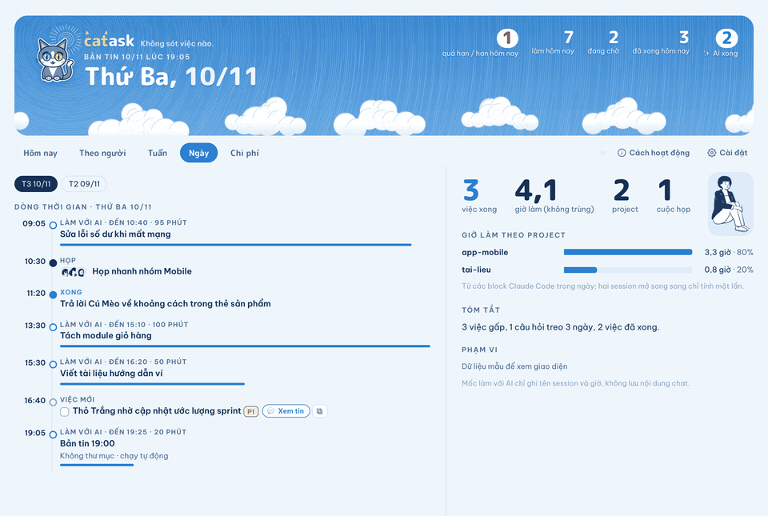</a></p>

### Screenshots

<table>
  <tr>
    <td width="50%"><a href="#screenshots">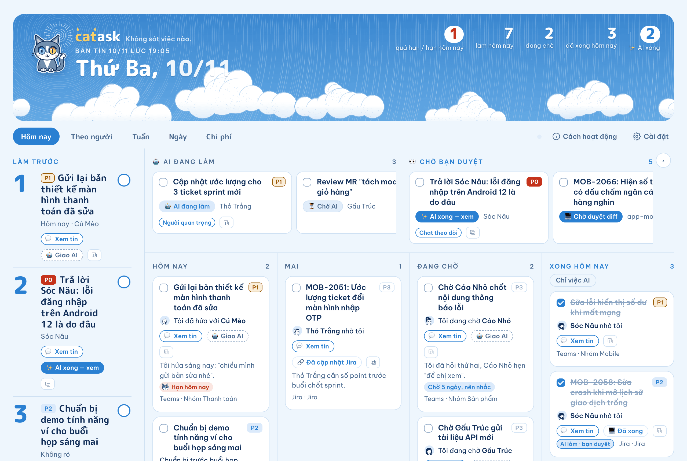</a><br><sub><b>Today</b>: top 3 and the Today / Tomorrow / Waiting / Done board</sub></td>
    <td width="50%"><a href="#screenshots">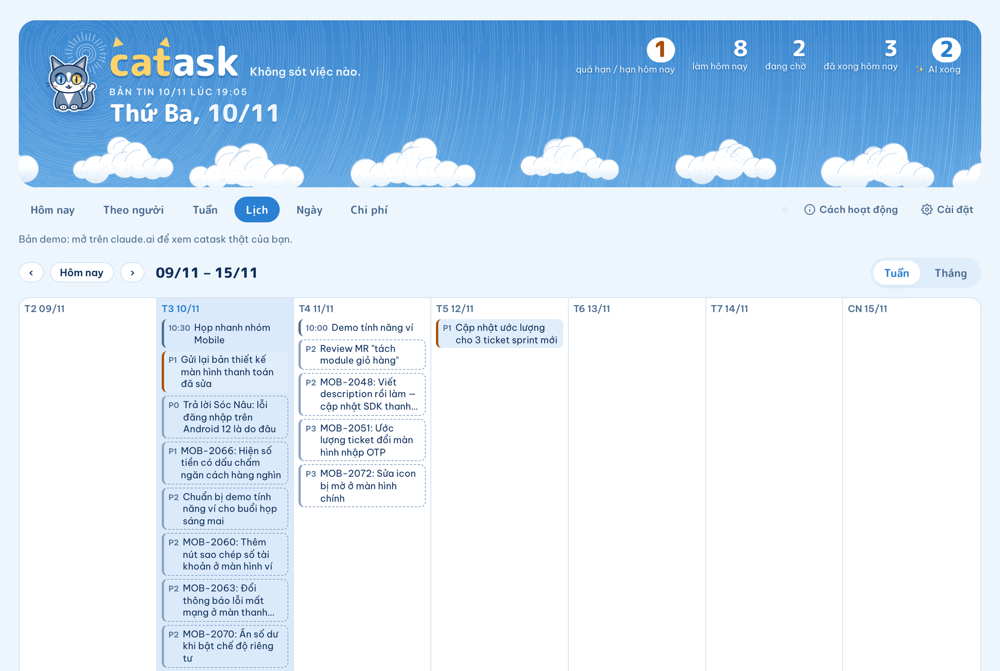</a><br><sub><b>Calendar</b>: week or month, drag a task to change its due date</sub></td>
  </tr>
  <tr>
    <td width="50%"><a href="#screenshots">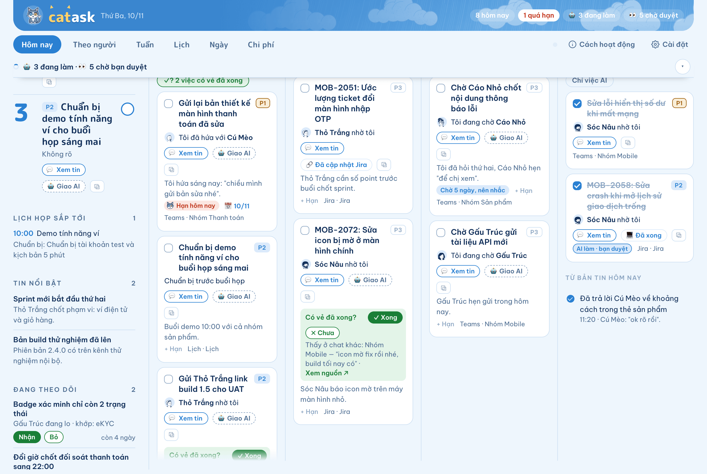</a><br><sub><b>Following</b>: others' work in your areas, out of your TODO list</sub></td>
    <td width="50%"><a href="#screenshots">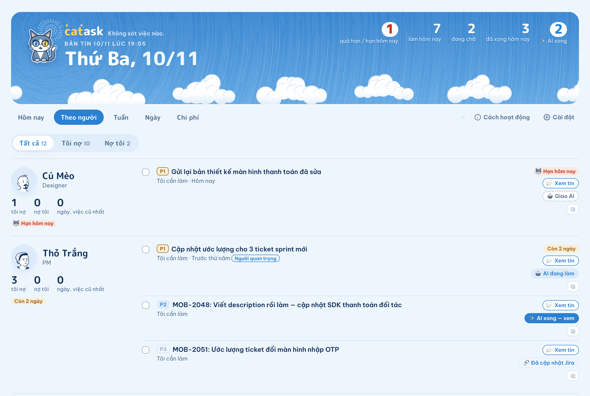</a><br><sub><b>People</b>: what you owe each person and what they owe you</sub></td>
  </tr>
  <tr>
    <td width="50%"><a href="#screenshots">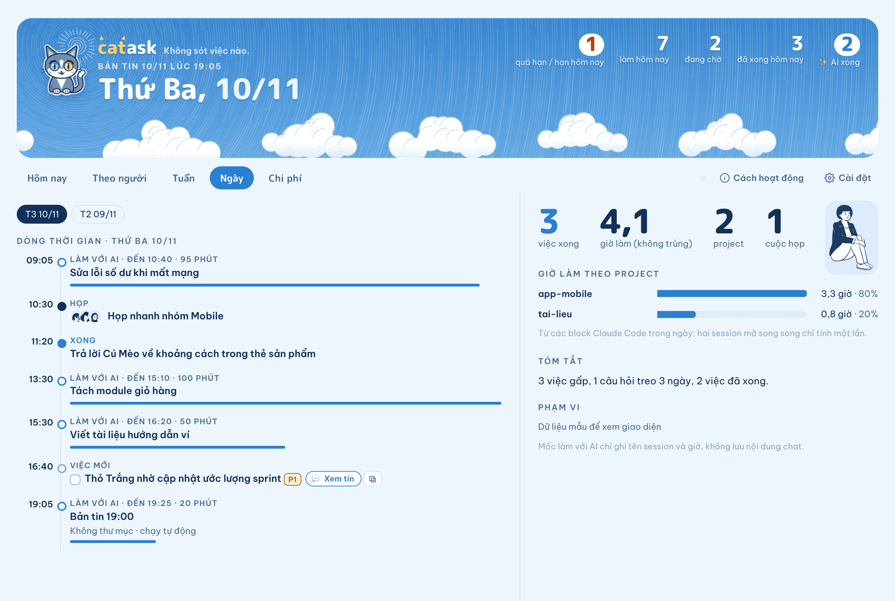</a><br><sub><b>Day</b>: timeline of meetings, AI sessions and finished work</sub></td>
    <td width="50%"><a href="#screenshots">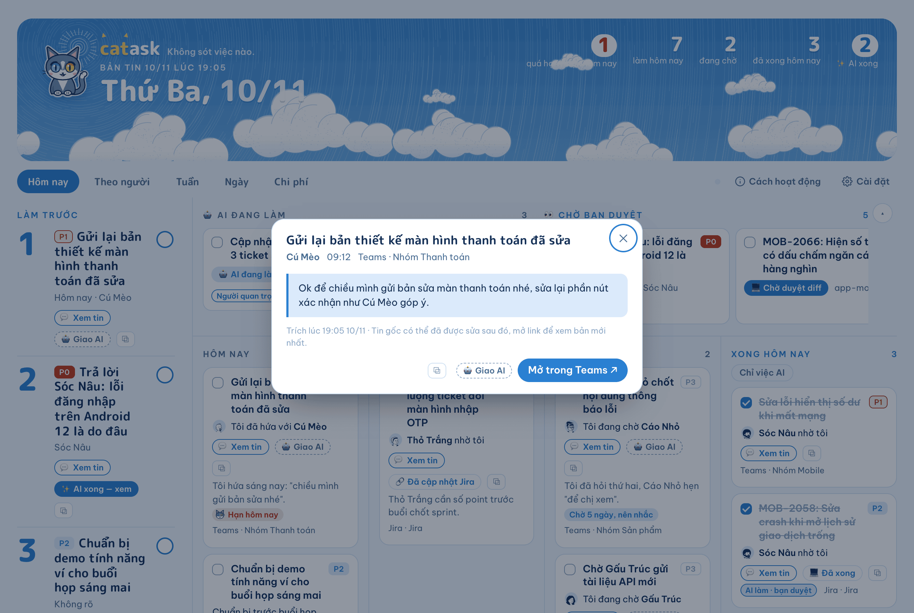</a><br><sub><b>View message</b>: short snapshot of the source message, with a link to the original</sub></td>
  </tr>
  <tr>
    <td width="50%"><a href="#screenshots">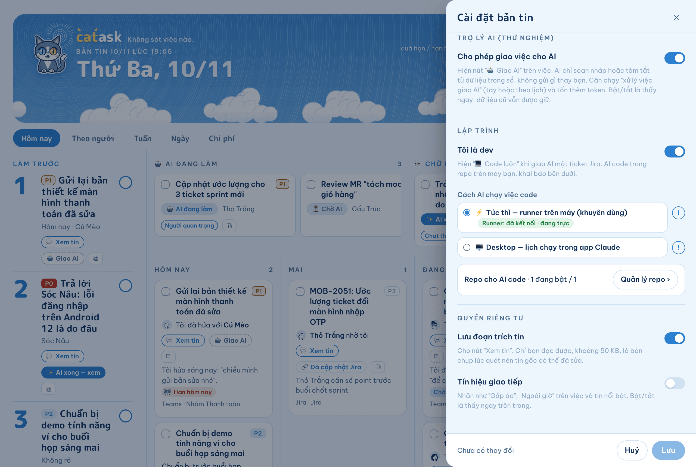</a><br><sub><b>Settings</b>: language, channels, work hours, important people, right on the page</sub></td>
    <td width="50%"><a href="#screenshots">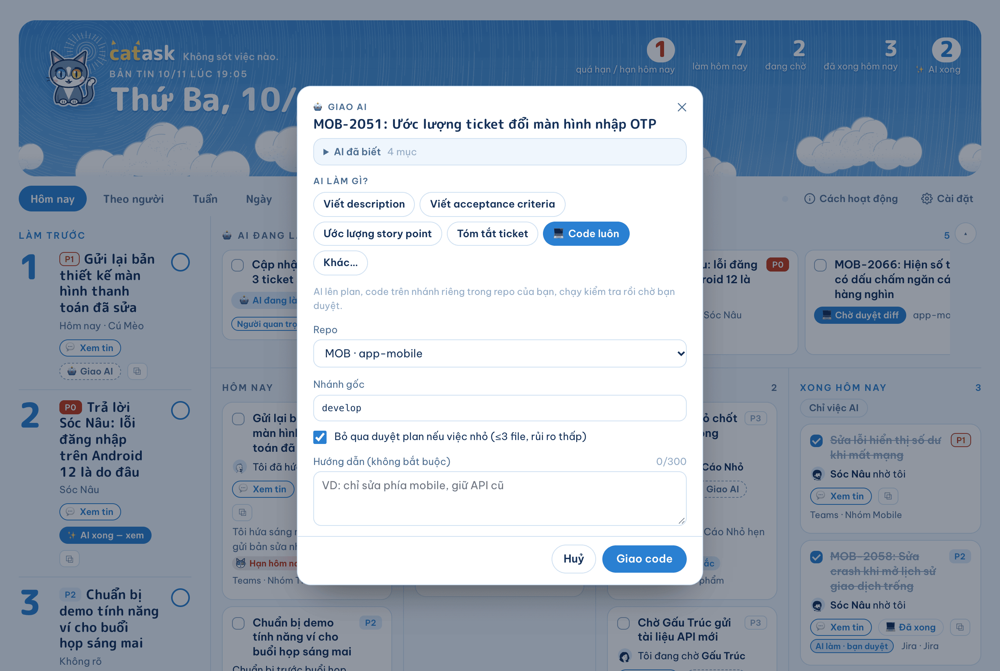</a><br><sub><b>Hand to AI</b>: pick what AI should do; on a Jira ticket, 💻 Write code works in your local repo</sub></td>
  </tr>
  <tr>
    <td width="50%"><a href="#screenshots">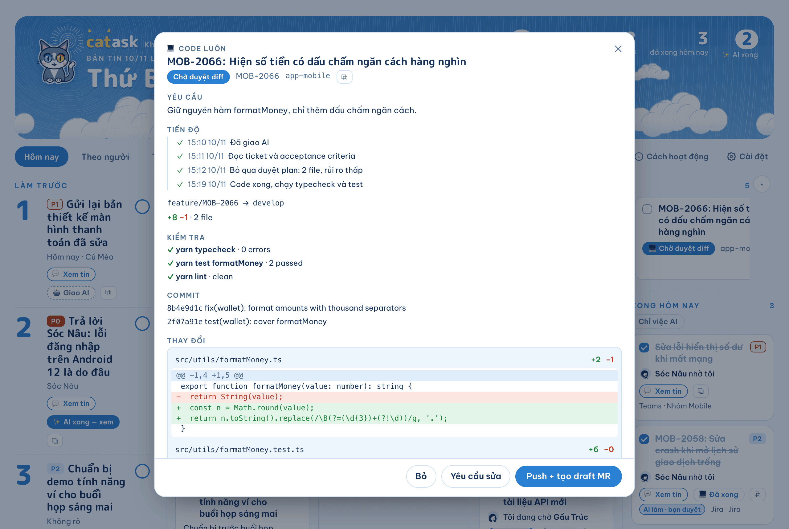</a><br><sub><b>Review code</b>: plan, checks and diff from the AI branch; you approve before push + draft MR</sub></td>
    <td width="50%"><a href="#screenshots">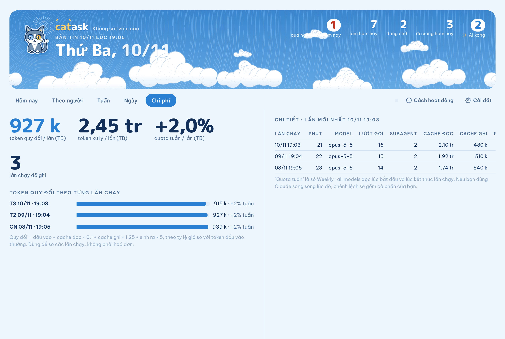</a><br><sub><b>Cost</b>: token cost of each scheduled run</sub></td>
  </tr>
</table>

<sub>Screenshots use the built-in demo data. No real messages or people.</sub>

## Quick start

Paste this into Claude Code (or the Code tab of the Claude desktop app):

```text
Install the catask plugin for me: run `claude plugin marketplace add hothienlong/catask`, then `claude plugin install catask@catask` (if my organization has catask in its plugin library, use `claude plugin install catask@claudeai-organization-library` instead). Then set it up right away: run /catask:setup. If that command isn't available yet in this session (new plugins load in the next session), find the installed setup file with `find ~/.claude/plugins -path '*catask*/commands/setup.md' -not -path '*/.trash/*'` (pick the newest version), read it and follow it now in this session. Don't ask me to open a new session for setup.
```

Or by hand:

```text
/plugin marketplace add hothienlong/catask
/plugin install catask@catask
/catask:setup
```

| Requirement | | Notes |
|---|:---:|---|
| Claude desktop app | ✅ | Runs the evening scheduled task |
| Microsoft 365 connector | ✅ | Settings → Connectors. Read access is enough |
| Python 3.9+ | ✅ | Standard library only |
| Atlassian connector | | Jira board counts and the read-only ticket check |

**First run (about 5 minutes).** `/catask:setup` asks 3–4 rounds of multiple-choice questions (language, key chats, important people, working hours, role, Jira boards), offers to create the evening schedule (nothing is scheduled without your yes), then publishes your private catask page and opens it. Pin it. Say **`update my profile`** later to change answers.

**Update:** `/catask:update`, or `/plugin marketplace update catask` then `/reload-plugins`. Organization-library installs update on restart.

## Features

| | |
|---|---|
| ✅ **Prioritized TODOs** | Asks to you, unanswered questions, your promises, deadlines, reviews, meeting prep. P0–P3 by impact; overdue and dated tasks first |
| 📅 **Due dates & Calendar** | Set or change a due date on any card; week/month Calendar tab, drag a task to another day |
| 👀 **Following** | Someone else's work in your areas sits in its own block, out of your TODO list. *Take it* or *Drop* |
| 🕵️ **Looks done?** | Evidence from chats, mail, merged MRs or Jira moves a card to *Looks done?*. Nothing closes without you |
| 🔁 **Carry-over & catch-up** | Unfinished tasks stay; a failed or missed evening run is caught up the next time you open Claude |
| 🗂 **One page, six views** | Today board, People, Week stats, Calendar, Day timeline, Cost. Undo on every change |
| ⚙ **Settings on the page** | Language, channels, hours, important people, key and skipped chats, Jira boards |
| 🤖 **Hand to AI** *(beta, off)* | Drafts replies, summaries, Jira descriptions and estimates; for developers, writes code on a branch you review |

## Hand to AI (beta, off by default)

Turn it on in ⚙ Settings, click **🤖 Hand to AI** on a task, then say **`process AI queue`** (or run `/catask:ai-worker`). AI only drafts: replies, summaries, meeting prep, Jira descriptions, acceptance criteria, estimates. It never sends anything; a Jira field changes only when you click *Approve & update Jira* on the page.

For developers (`devMode`), **Code it** on a Jira task plans and writes the change on its own branch in your local repo, runs the checks and shows you the diff. It pushes and opens a **draft** MR only after you approve. Details: [full guide](docs/guide.md).

## How it works

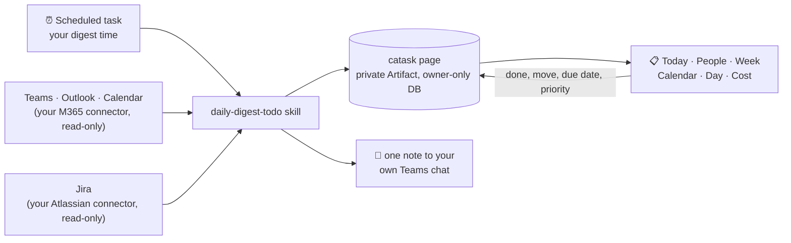

- **Reads** through your own Claude connectors, in your own Claude session. Chat reading fans out to cheaper subagents (Sonnet by default).
- **Writes** only to your catask page and one message to your own notes chat.
- **Remembers** your choices: a priority or due date you set on the page is never overridden.

## Configuration

Settings live in `~/.catask/config.json` (example: [`config.example.json`](config.example.json)); most can be changed in the page's ⚙ Settings. Say **`update my profile`** to redo setup.

| Field | Default | Meaning |
|---|---|---|
| `language` | asked | `vi` or `en` for the digest and the page |
| `workHours` / `digestTime` | 09:00–18:00 Mon–Fri / `null` | Digest runs at end of work + 1 h unless set |
| `keyChats` / `excludeChats` / `watchChats` | `[]` | Always read / never read / skim for alarms only |
| `vipPeople` | `[]` | Their asks are at least P1 |
| `focusAreas` / `keywords` | `[]` | What counts as your area (feeds *Following*) |
| `jiraProjects` / `jiraCheck` | `[]` / `true` | Your boards; read-only ticket check |
| `catchUp` | `true` | Restart a failed or missed digest |

All fields: [full guide → Configuration](docs/guide.md#configuration-catask-configjson).

## Privacy

- **No catask server, no telemetry.** Data lives in your own owner-only Artifact and in `~/.catask/` on your Mac.
- **Read-only** on Teams, Outlook and Jira. Nothing is sent on your behalf except one note to your own chat; a Jira field changes only when you approve it on the page.
- Message and mail content is treated as **data, never instructions**. Anyone else opening your page link sees demo data only.

Details and retention: [full guide → Privacy](docs/guide.md#privacy).

## Develop

```bash
node scripts/build-page.mjs                       # page-src/catask.src.html → assets/catask.html
FAKE=2026-11-17 node tests/smoke.js skills/daily-digest-todo/assets/catask.html vi demo
node hooks/selftest.mjs && node runner/selftest.mjs
```

Edit `page-src/catask.src.html`, never the generated page. Release: bump `version` in both `.claude-plugin/*.json`, add a `CHANGELOG.md` entry, push, then republish to the organization library. See [Develop](docs/guide.md#develop) and [Releasing](docs/guide.md#releasing-a-new-version).

## License

MIT, © 2026 Hồ Thiên Long. People illustrations: [Open Peeps](https://www.openpeeps.com/) by Pablo Stanley, CC0.
