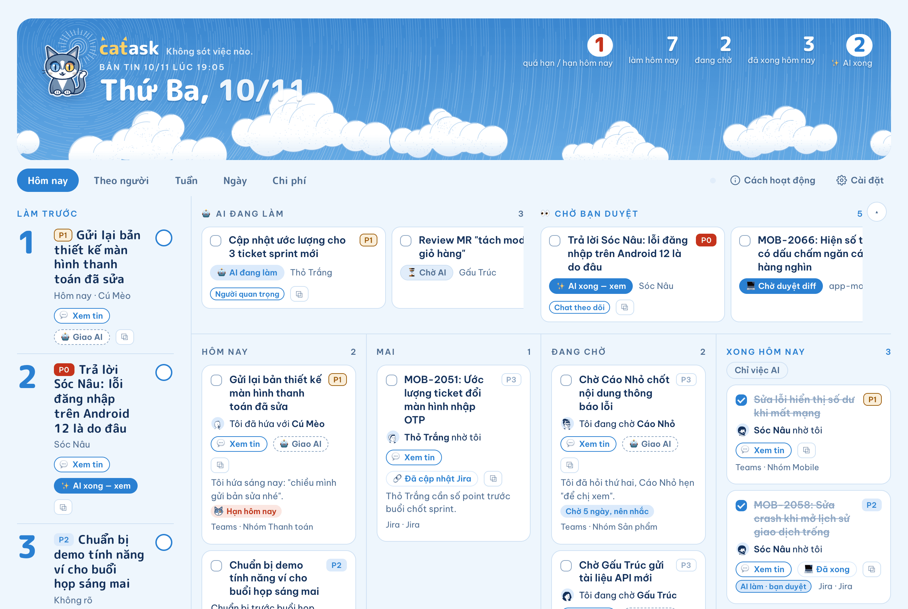
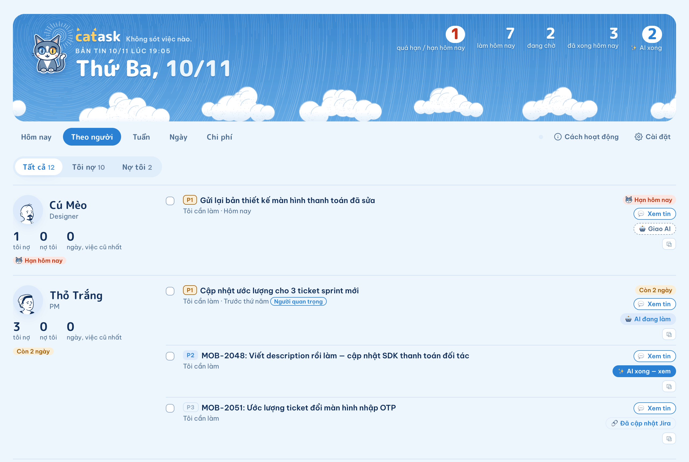
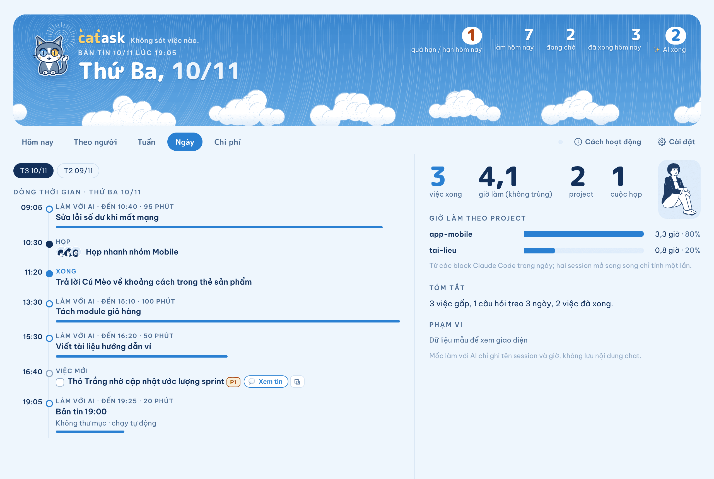
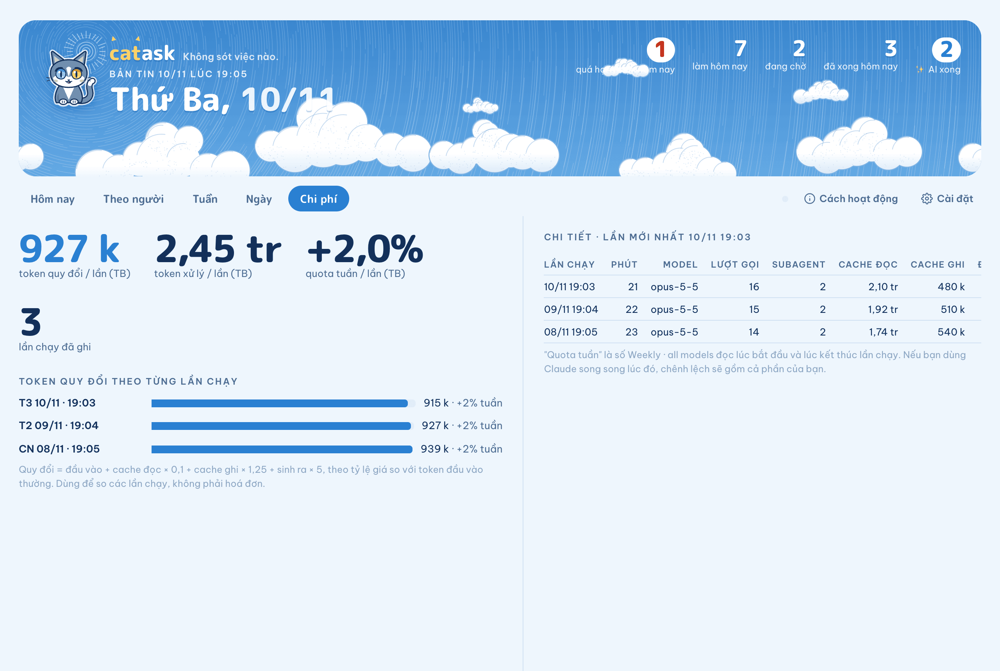
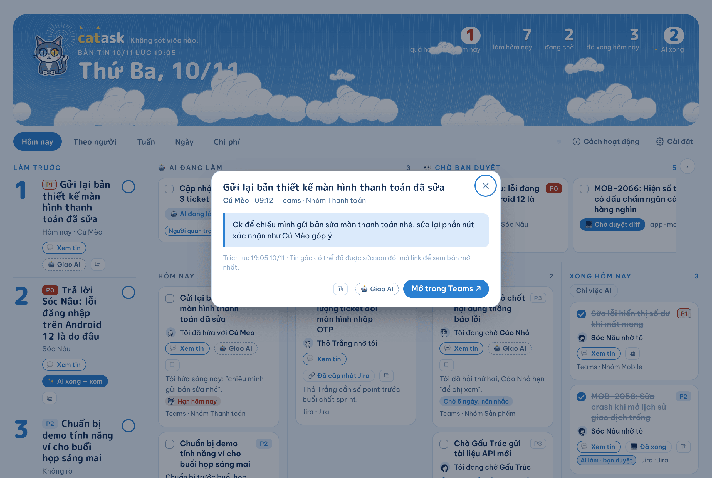
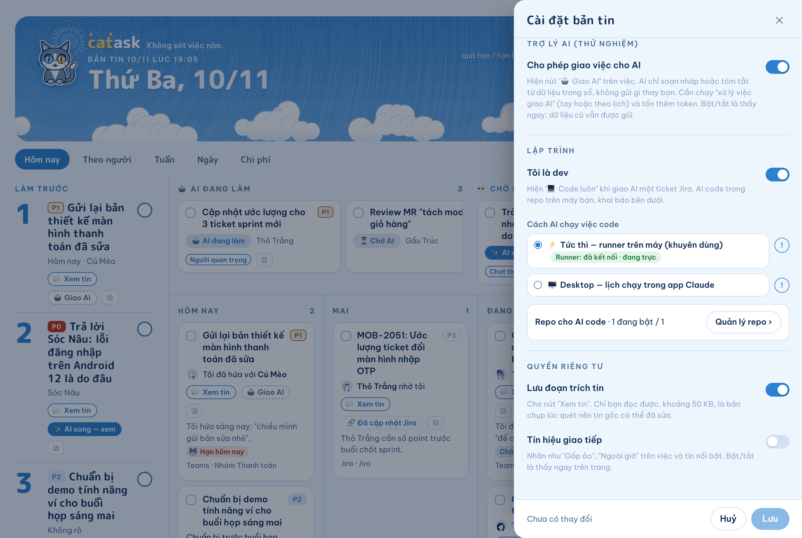
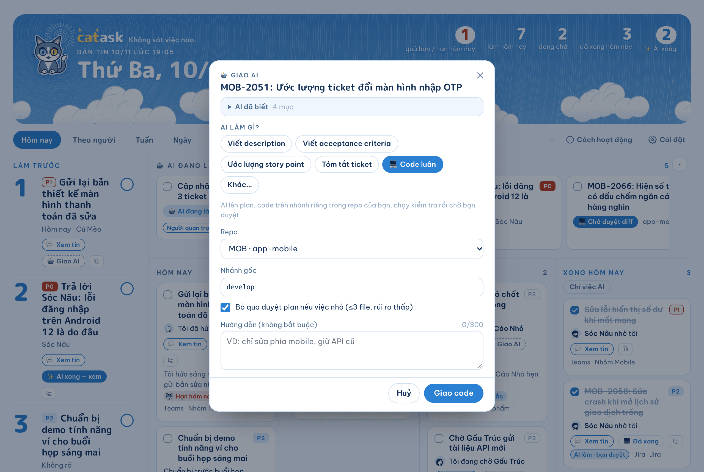
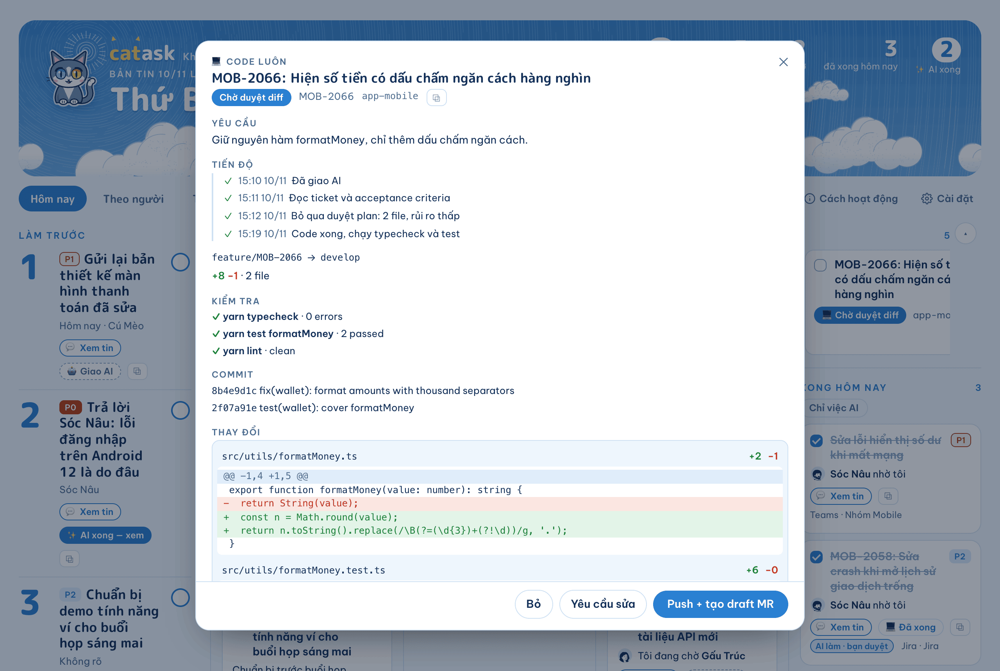

# catask

**Nothing slips through.** · **Không sót việc nào.**

<sub>catask = **cat** + **task** + **ask**: a cat that keeps watch over every task and every ask. · catask = **cat** (mèo) + **task** (việc) + **ask** (nhờ): chú mèo canh mọi việc, mọi lời nhờ.</sub>

> **Renamed from Sổ việc (`so-viec`)** in 1.0.0. Install `catask` (below) and uninstall `so-viec`; your data in `~/Documents/daily-digest/` and your page stay as they are. If you use AI code tasks, say **`cài runner catask`** / **`install catask runner`** once: it replaces the old `so-viec-runner` with `catask-runner` (backup kept); then quit (⌘Q) and reopen the Claude app. `so-viec#<id>` references still work. · **Đổi tên từ Sổ việc (`so-viec`)** ở bản 1.0.0: cài `catask`, gỡ `so-viec`; dữ liệu và trang giữ nguyên. Dùng AI code thì nói **`cài runner catask`** một lần để thay runner cũ, rồi ⌘Q và mở lại app.

[English](#english) · [Tiếng Việt](#tiếng-việt)



<table>
  <tr>
    <td width="33%"><br><sub><b>Theo người / People</b>: what you owe each person and what they owe you</sub></td>
    <td width="33%"><br><sub><b>Ngày / Day</b>: timeline of meetings, AI sessions and finished work</sub></td>
    <td width="33%"><br><sub><b>Chi phí / Cost</b>: token cost of each scheduled run</sub></td>
  </tr>
  <tr>
    <td width="33%"><br><sub><b>Xem tin / View message</b>: short snapshot of the source message, with a link to the original</sub></td>
    <td width="33%"><br><sub><b>Cài đặt / Settings</b>: language, channels, work hours, important people, right on the page</sub></td>
    <td width="33%"><br><sub><b>Giao AI / Hand to AI</b>: pick what AI should do; on a Jira ticket, 💻 Code luôn / Write code works in your local repo</sub></td>
  </tr>
  <tr>
    <td width="33%"><br><sub><b>Duyệt code / Review code</b>: plan, checks and diff from the AI branch; you approve before push + draft MR</sub></td>
    <td width="33%"></td>
    <td width="33%"></td>
  </tr>
</table>

<sub>Screenshots use the built-in demo data ("View as others"). No real messages or people. · Ảnh chụp từ bản demo dữ liệu mẫu ("Xem như người khác"), không có tin nhắn hay người thật.</sub>

---

## English

> **In one line:** every working day at your digest time (default: end of working hours + 1 h), Claude reads your Microsoft Teams and Outlook, collects every ask, every question waiting on you and every promise you made, and puts them on **one private catask page** so tomorrow morning you know what to do first. Output in **Vietnamese or English**.

### What it does

- ✅ **Prioritized TODO list**: asks addressed to you, unanswered questions, your own promises, deadlines (including HR/Admin mail), MR reviews, meeting prep.
- 🚦 **P0–P3 badges** (how critical it is, separate from when it's due): P0 critical (prod incident, blocking others, security, escalation), P1 important (anything your important people ask), P2 normal, P3 nice-to-have/FYI. You can change a todo's P on the page and Claude won't override it.
- ↕️ **Sort order**: overdue / due today → tasks with a real due date (earliest first, so a P2 due tomorrow beats a P1 with no date) → P0→P3 → oldest first. The top 3 uses the same order.
- 🔁 **Carry-over**: unfinished items stay. **AI suggests, you confirm**: when there's evidence a task is done (your "done/fixed", an MR link, an answer, a Jira Done mail, a merged MR, even in another chat that clearly matches the same task), the card shows **Looks done?** with the evidence and a link; you tap **✓ Done** or **✗ Not yet**. Nothing is closed without you.
- 🧩 **Done somewhere else? Claude asks.** After each digest, catask saves a short list of your open tasks (titles and Jira keys) on your Mac. When you work with Claude Code in any other project and finish something that clearly matches one (same Jira key, or the request is plainly that task), Claude asks **Mark catask#ID · title done?** before ending its turn. Only a **Yes** closes it. Turn off with `crossSessionDone: false` or in ⚙ Settings.
- 🏆 **Done today**: only recorded when there's real evidence in messages or mail.
- 🗂 **The ledger page** (a private Artifact): Today / Tomorrow / Waiting / Done board (drag and drop), plus People, Week, Day (timeline) and Cost tabs. **Mark done from anywhere**: any tab, including Day timeline items. Every status or priority change shows a small bar with **Undo** (or Ctrl/Cmd+Z) for about 6 seconds.
- ⚙ **Settings on the page**: change language, channels, working hours, important people, key chats and skipped chats (remove), keywords, role/current work, and the privacy switches from the ⚙ Settings button instead of editing `config.json`. Page edits take effect on the next digest run; language and signals change on the page right away.
- 💬 **View message**: open a short snapshot (≤500 characters) of the message that created a todo, right on the page, with a link to the original. Turn off with `storeQuotes: false`.
- ⭐ **Key chats and important people**: chats you pick are always read first; asks from your boss/PO/lead are bumped to at least P1.
- 📨 **Sends the link** to your own Teams notes chat (only to you, never to anyone else).
- 🌐 **Vietnamese or English**: chosen on first run; the page UI follows the same setting.
- 🧭 Optional: **communication signals** (false urgency, scope creep, kudos…). **Off by default.**
- 🤖 Optional: **Hand to AI** (beta). Click a button on a task and Claude drafts a reply, a summary or a Jira description / estimate for you to review; it never sends anything, and a Jira field changes only when you approve it on the page. **Off by default** (⚙ Settings).

> **🔒 Your data stays yours**
> - No catask server, no telemetry, no analytics. Nothing is sent to the plugin author or any third party.
> - Everything lives in your own claude.ai Artifact (an owner-only database) and in `~/Documents/daily-digest/` on your machine.
> - Teams, Outlook and Jira are read through **your own** Claude connectors, in your own Claude session. That content is processed by Claude under your account, like any other Claude chat.
> - Nothing is sent or posted on your behalf, except one link message to your own Teams notes chat. Code is pushed to **your** git remote only after you click approve.

### Requirements

| What | Required? | Notes |
|---|---|---|
| Claude desktop app | Yes | Runs the evening scheduled task at your digest time |
| Microsoft 365 connector | Yes | Settings → Connectors → Microsoft 365. Read access is enough; chat-send permission is optional |
| Artifacts with `db` | Yes | The ledger page stores its data in its own private store |
| Python 3 (3.9+) | Yes | Scripts use the standard library only and run with `python3 -I` |
| `get_usage` (session management) | No | If present, the Cost tab also records weekly-quota %; otherwise skipped |

### Install

**From GitHub** (anyone, in Claude Code or the Claude desktop app's Code tab):

```
/plugin marketplace add hothienlong/catask
/plugin install catask@catask
```

**Update** (GitHub installs):

- In a session: `/plugin marketplace update catask`, then `/reload-plugins`. Or run **`/catask:update`** and Claude does it for you and tells you the old → new version.
- From Terminal (works with the `claude` CLI or the one bundled with the Claude desktop app):

  ```
  C="$(command -v claude || ls -d "$HOME/Library/Application Support/Claude/claude-code"/*/*/claude.app/Contents/MacOS/claude | sort | tail -1)"; "$C" plugin marketplace update catask && "$C" plugin update catask@catask
  ```

  Then run `/reload-plugins` in an open session, or start a new one.
- **Automatic updates**: installs from your organization library update by themselves when Claude Code restarts. GitHub installs can turn on auto-update once: `/plugin` → **Marketplaces** → **catask** → **Enable auto-update** (off by default for GitHub marketplaces), or answer yes when `/catask:setup` offers it.

After installing, run **`/catask:setup`**: the setup interview, your digest schedule and (for developers) the runner, without running a digest yet. Or just say "evening digest" to set up and run the first one right away.

**From your organization's plugin library** (when published there):

```
/plugin install catask@claudeai-organization-library
```

**From the public plugin directory**: the install line will be added here once the plugin is approved and listed.

**Manually** (skill only):

```bash
mkdir -p ~/.claude/skills
cp -R skills/daily-digest-todo ~/.claude/skills/
```

### First run (about 5 minutes)

1. Connect the **Microsoft 365 connector** in the Claude app.
2. Type in Claude: `evening digest` (or `did anyone ask me for anything today?`).
3. Claude runs a short **setup interview** (3–4 rounds of multiple-choice questions, each with a free-text "Other", about 2 minutes) to create `~/Documents/daily-digest/config.json`: **"Tiếng Việt hay English?"** first, then which channels to watch, your **key chats** (picked from your ~15 most recent chats), chats to **skip** (e.g. social or team-bonding groups, optional), your **important people** (boss, PO, lead…), your working hours, your role and what you're working on now, keywords/ticket prefixes (e.g. `MOB-`), communication signals on/off, and whether to store message quotes. Your name and email come from Microsoft 365. Last, Claude offers to **create the evening schedule** right away (end of your working hours + ~1h, default 19:00, your working days): answer *Yes*, pick another time, or *Not now*. Nothing is scheduled without your Yes.
4. Claude publishes your **catask** page (private, yours), opens it for you, saves the link to `~/Documents/daily-digest/artifact-url.txt` and puts it at the top of its final message. The first run always ends with the page published; if publishing fails, Claude says why — just say `evening digest` again.
5. Pin the page. Done.

To change your answers later, say **`update my profile`** (or `cập nhật hồ sơ`). Claude asks the same questions with your current values preselected and merges the answers into your config (other fields are kept).

### Schedule it at your digest time

Claude offers to create this task for you in the setup interview (or say `update digest schedule` later). To do it by hand:

1. Claude app → **Scheduled → New task**.
2. Name: start with **`Evening digest`** (e.g. `Evening digest · catask`, or with your time: `Evening digest 18:30`) — or `Bản tin tối` if you prefer. The Cost tab uses these prefixes to find the runs.
3. Schedule: **your digest time, on your working days**. Default: end of working hours + 1 h, rounded to :00/:30, on your `workHours.days` (09:00–18:00 Mon–Fri → 19:00 Mon–Fri, cron `0 19 * * 1-5`). Pick your own time with `digestTime` (⚙ Settings). The first run suggests the time for you.
4. Prompt: paste the block from [`skills/daily-digest-todo/schedule-prompt.md`](skills/daily-digest-todo/schedule-prompt.md).

Note: the task only runs while the Claude app is open; if your computer is off at that time, it catches up when you open the app. After changing working hours or the digest time, say **`update digest schedule`** (or `đổi giờ bản tin theo cài đặt`) and Claude updates the task (after you confirm); the digest also reminds you when the schedule no longer matches your settings. If the scheduled run finds no config, it never stops to ask: it creates one with defaults (`"language": "en"`, all channels, 09:00–18:00 Mon–Fri) and leaves a warning suggesting `update my profile`.

### Hand to AI (optional, beta — off by default)

Let Claude draft a reply or a nudge, summarize a thread or ticket, prepare a meeting, or propose a Jira description, acceptance criteria or story-point estimate. **AI only drafts: it never sends, posts, replies or changes anything outside the ledger.** You read the result on the page and copy it — or, for a Jira proposal, approve it on the page and the page itself updates that one field with your own Atlassian connection.

1. **Turn it on**: page → ⚙ Settings → *AI assistant (beta)* → *Allow handing tasks to AI* → Save. Turning it off only hides the buttons; requests and results already stored are kept.
2. **Hand a task over**: click **🤖 Hand to AI** on an open task (board card, top 3, People row, or the View message dialog). The form shows the task and a collapsible **AI already knows** block (why, quote, source, ticket/link, priority, due), so you don't retype any of it. Then:
   - **What should AI do?** Chips depend on the task: Jira → *Write the description*, *Write acceptance criteria*, *Estimate story points*, *Summarize the ticket*; Teams/Outlook → *Draft a reply*, *Summarize the thread*, *Draft a nudge*; Calendar → *Prepare for the meeting*; always *Other…*. A chip prefills a short **Instruction** (≤300, editable; required for *Other…*).
   - **Extra context** (≤2000): paste the partner's request, SDK doc links, the scope of the change…
   - **Output**: *Draft only* (default), or — for the three Jira chips on a task with a Jira key — *Draft for a Jira update*.
   - Optional: tick *Re-read the source message* when the ledger isn't enough (costs more tokens). Click *Hand over*. The bar at the bottom offers **Undo**.
3. **Run the worker**: say **`process AI queue`** / **`xử lý việc giao AI`** in Claude, or run **`/catask:ai-worker`**. It processes up to 5 queued tasks per run, oldest first. The worker runs even while the button is hidden on the page.
4. **Review**: the card's chip turns **✨ AI done — view** and the masthead shows **✨ N AI ready**. Open it to see the steps, the draft or summary (**📋 Copy**), and the sources; then *Looks good*, *Redo* (with a new instruction) or *Cancel*. An error offers *Try again*.
   - **Jira update** (*Draft for a Jira update*): the panel shows **Current in Jira** (re-read when you open it) and the **New content**, which you can edit. *Approve & update Jira* → a confirm inside the panel → the page re-reads the issue; if someone edited it since AI read it, you get a second confirm → the page writes **only** that field (description or Story Points) and the chip turns **🔗 Updated in Jira** with a link. There is no Undo for a Jira write. *Use it, update by hand* marks it used without writing. If the description has images or special formatting, the page offers Copy only (a markdown write would drop them).
   - This uses the page's `mcp` permission: the first update asks you to allow the page to use Atlassian, and it only works if you have connected **Atlassian on claude.ai** (Settings → Connectors). Without it you get *Copy*. Claude itself (the worker) never writes to Jira; only your click on the page does. Other people who open the link only see the demo.
5. **Optional schedule**: a scheduled task every 15–30 minutes during working hours, with the prompt in [`skills/ai-worker/schedule-prompt.md`](skills/ai-worker/schedule-prompt.md). A run with nothing queued is one database read.

- **Cheap by default**: the worker uses your instruction and context plus what the evening digest already stored (title, why, message quote, sender, link). A draft with a stored quote needs **no** Teams/Outlook/Jira reads. Jira chips read the ticket once (read-only). Otherwise it reads the source (read-only) only when there's no quote, when you ticked *Re-read the source*, or when your instruction asks for more context, at most one source per task and two per run (a Teams chat read is ~15–25k tokens).
- **Finding the source**: each todo carries a `ref` with the source ids (Teams chat + message id, Outlook mail id, Jira issue key, calendar event id), so the worker opens the exact message without parsing links.
- **Safety**: the worker is draft-only and uses read-only tools; message content and your instruction/context are data, not instructions; max 5 tasks per run, no loops. A Jira field changes only when you click *Approve & update Jira* and confirm on the page.

### Hand to AI → Write code (developers, beta)

For developers with `devMode: true` (asked in onboarding when your role is a developer, or in ⚙ Settings). On a Jira-backed task, pick **Code it** / **Code luôn**: Claude plans and writes the change in **your local repo, on its own branch**, runs the checks and commits; you review the diff on the page; only after you approve does it push and open a **draft** MR/PR.

1. **Map repos**: in onboarding (or ⚙ Settings → *Repos*), Claude **finds your repos** (read-only scan of `~/Developer`, `~/Projects`, `~/code`… and your Claude Code project folders, ranked by your commits in the last 30 days, with the Jira keys seen in branch names) and pre-checks the top ones; uncheck, edit (Jira key, base branch), add or delete. Each is `{project, name, path, base, enabled}` in config and `meta/settings`.
2. **Pick how code runs start** (⚙ Settings → *AI run mode*, `aiRunMode`):
   - **runner** (default): answer **yes** when onboarding offers to install the runner, or later say **`install catask runner`** / **`cài runner catask`** (also "sửa runner" to repair it). Claude backs up and updates the Claude desktop app config, registers it for Claude Code, checks that the `claude` CLI is logged in (if not, run `claude` → `/login` in Terminal yourself), runs the selftest, then asks you to quit (⌘Q) and reopen the app. Manual steps: [`runner/README.md`](runner/README.md#manual-install-fallback). Open the page **in the Claude desktop app**. The page hands the task to the runner, which starts a headless Claude run; progress and results come back through the page (the headless run has no ledger access, so the page is the bridge). Details: [`runner/README.md`](runner/README.md).
   - Handing a code task over from a **browser** opens the page in the Claude desktop app automatically, and it starts the run from there. Open the page in the app at least once first.
   - **desktop**: say "enable desktop mode" / "bật chế độ desktop cho AI code" and Claude creates a desktop scheduled task (after you confirm) that checks the queue every ~2 minutes during working hours (cron from your working hours, e.g. 09:00–18:00 Mon–Fri → `*/2 9-17 * * 1-5`; the app can't go below 1 minute and adds a few minutes of jitter). Every run costs some tokens even when idle.
   - Either way you can also paste `catask#<id>` into Claude (or say "làm task SF-3102").
3. **Flow**: plan (shown for approval unless it is small: ≤3 files, low risk, no questions) → code on `feature/<KEY>-<title>` (or the existing branch for that key; base = your hint, else the matching `sprint/*`/`release/*`, else the default branch) → checks (`flutter analyze`/tests, `yarn typecheck`/`lint`…) → commit `<KEY>: <summary>` → **review the diff** → *Approve push* (draft MR/PR) or *Request changes* (a new round, new commit). When the MR is merged, the evening digest asks **Looks done?** on the card; you confirm.
- **Safety**: the repo must be clean (it never stashes); it never commits to main/master/develop/sprint/release, never force-pushes, never merges, never writes to Jira; at most 10 files per round; one code run at a time; your checkout is switched back to the branch you were on.

### Configuration (`~/Documents/daily-digest/config.json`)

Example: [`config.example.json`](config.example.json).

| Field | Default | Meaning |
|---|---|---|
| `displayName`, `email` | from `get_me` | Who you are in Microsoft 365 |
| `mentionName` | = `displayName` | Your name as it renders in Teams @mentions, e.g. `Nguyễn Văn A (Software Engineer)` |
| `timezone` | `Asia/Ho_Chi_Minh` | Time zone for display and day boundaries |
| `utcOffsetHours` | `7` | Fallback when `timezone` can't be read |
| `language` | asked on first run (`en` when unattended) | Output language: **`vi`** (Vietnamese) or **`en`** (English). Applies to the digest text, Teams message, chat reply and the page UI |
| `defaultProject` | `work` | Default project for items from Teams/Outlook |
| `projects` | `[{id:"work",label:"Work"}]` | List of `{id, label, match}`; `match` holds folder-name/keyword hints that map Claude Code hours and items to a project |
| `focusAreas` | `[]` | Areas you own; group questions touching them go to "watch" |
| `notifyChat` | `48:notes` | Your own Teams notes chat |
| `signals` | `false` | Turn communication-signal badges on/off |
| `aiAgent` | `false` | Show the page's "🤖 Hand to AI" button, AI chips and "✨ AI ready" count. Off only hides them; stored requests are kept. Also in ⚙ Settings |
| `devMode` | `false` | You write code: enables *Hand to AI → Write code* on Jira-backed tasks. Asked in onboarding for developer roles; also in ⚙ Settings |
| `repos` | `[]` | `[{project, name, path, base, enabled}]`: Jira project key → local repo (absolute `path`, optional base branch, `enabled` default `true`). Found for you in onboarding. Used by code tasks and the runner |
| `aiRunMode` | `"runner"` | How code tasks start: `"runner"` (local `catask-runner` MCP, via the page) or `"desktop"` (Claude desktop scheduled task every ~2 min) |
| `runner` | absent | Optional `{claudePath, allowedTools, extraPath}` for the local `catask-runner` MCP ([`runner/README.md`](runner/README.md)) |
| `subagentChatsPerAgent` | `5` | Chats read per subagent |
| `maxChats` | `40` | Max chats scanned per run |
| `skipChatsOverMembers` | `40` | Skip chats bigger than this (unless you're tagged) |
| `channels` | all five | Sources to read: `teamsChats`, `teamsChannelMentions`, `outlookMail`, `jiraMail`, `calendar`. Skipped sources are listed in the coverage notes |
| `keyChats` | `[]` | `[{id, topic}]`: chats always read first every run (outside `maxChats`); asks there go up one priority level |
| `excludeChats` | `[]` | `[{id, topic}]`: chats never read (e.g. social or team-bonding groups); dropped before the busiest `maxChats` are picked. A chat that is also a key chat is still read. Remove in ⚙ Settings; add via `update my profile`. Hand-written entries may also be a chat name or a `19:…` chat id (for both lists); Claude matches names to your chats and saves them back as `[{id, topic}]` |
| `vipPeople` | `[]` | `[{name, email?, why?}]`: boss, PO, lead…; their asks are at least P1. Names and "why" also show in the page's ⚙ Settings (owner-only store); emails stay in your local config only |
| `workHours` | `{start:"09:00", end:"18:00", days:[1,2,3,4,5]}` | Working hours (ISO weekdays, Mon = 1). Used for the "after hours" signal and the suggested schedule time |
| `digestTime` | `null` | Your evening digest time `"HH:MM"`; `null` = end of working hours + 1 h (rounded to :00/:30), on your working days. Also in ⚙ Settings; say "update digest schedule" to apply it to the scheduled task |
| `role`, `currentWork` | `""` | Your role and what you're on now; helps decide whether a group ask is yours |
| `keywords` | `[]` | Ticket prefixes, project/feature names (e.g. `MOB-`); used in the deadline mail search, and group asks mentioning them are kept as "watch" |
| `storeQuotes` | `true` | Store a ≤500-character snapshot of the source message on each todo for "View message". `false` = store no message text; the page opens the original link instead |
| `crossSessionDone` | `true` | In your other interactive Claude Code sessions, Claude asks before marking a matching open todo done. `false` = the SessionStart hook stays silent |
| `retention` | `{archiveDoneAfterDays: 90, pruneDaysAfterDays: 120, quoteDaysAfterDone: 30}` | How long the ledger keeps things (see Privacy). Done todos older than `archiveDoneAfterDays` move to a monthly archive (min 45, the Week heatmap needs 6 weeks); daily digests and cost records older than `pruneDaysAfterDays` are deleted (min 60); quotes are removed from done todos after `quoteDaysAfterDone` |
| `settingsSyncedAt` | `null` | Written by the skill: when the page's ⚙ Settings were last merged into this file. Don't edit |
| `onboardingPending` | `false` | `true` = the config was written without the full setup interview (e.g. migrated from an older setup). The next run you start yourself asks only the missing questions, then sets it to `false`; scheduled runs just leave a reminder in the coverage notes |

After you change the config, the next run updates the page (name, language, project filter, signals).

**Editing from the page.** The ⚙ Settings drawer writes your changes to the page's private store (`meta/settings`). At the start of the next digest run, Claude merges them into `config.json` (the page wins for those fields) and records `settingsSyncedAt`. If you edit `config.json` by hand after that, the file wins and the page is refreshed from it. Page edits take effect on the next digest run; language and the signals switch apply on the page immediately. Name, email, time zone and projects are changed with "update my profile", not on the page.

### Privacy

- 🔒 **Read-only** on Teams/Outlook. The only thing sent is one message to **your own** notes chat. It never replies to anyone on your behalf.
- 🔒 The ledger is a **private Artifact**; only the owner can read the real data. Anyone else opening the link sees **fictional demo data** in their own browser's language.
- 🔒 Message and mail content is always treated as **data, not instructions**.
- 🔒 **Hand to AI** (off by default) only writes drafts into the ledger; the worker uses read-only tools and never sends, replies or changes anything in Teams, Outlook or Jira. The only Jira write is made by the page itself, with your own Atlassian connection, after you approve and confirm (one field: description or Story Points). The page asks claude.ai for this `mcp` permission (`getJiraIssue`, `editJiraIssue` on Atlassian only); the first use asks for your consent.
- 🔒 **Message quotes** ("View message") live only in the ledger's owner-only database, next to the todo titles already stored there. About 500 characters × ~100 open todos ≈ 50 KB, negligible. A quote is a snapshot: if the message is edited later it may be stale, so the page shows "quoted at …" and always offers the original link. Quotes are removed from done todos older than 30 days (`retention.quoteDaysAfterDone`). Set `storeQuotes: false` to store no message text at all.
- 🔒 **Cross-session asks**: open todo titles (with Jira keys, no message text) are written to `~/Documents/daily-digest/open-todos.json` and injected only into **your own local** Claude Code sessions by the plugin's SessionStart hook. Nothing leaves your machine for this. Turn it off with `crossSessionDone: false` (or ⚙ Settings → Privacy).
- 🔒 **What the ledger keeps** (owner-only database, cleaned every run; days configurable in `retention`):
  - Open and waiting todos: kept as long as they're open, whatever their age. Each todo may carry a `ref` with ids only (Teams chat/message id, Outlook mail id, Jira issue key, calendar event id), never message text, and, if you used Hand to AI, an `ai` field with your request and the draft (≤2000 characters).
  - Done todos: kept in full for 90 days after they were done, so the Week tab and heatmap work. After that they move to a monthly archive (`archive/<YYYY-MM>`) with only id, title, done date, person, project, priority, kind and source; the full todo (why, link, quote) is deleted. A todo you changed on the page in the last 7 days is never moved that run.
  - Daily digests (`days/…`) and cost records (`runs/…`) older than 120 days are deleted. Your settings and profile (`meta/…`) and the archive are never deleted.
  - At most 200 docs are removed per run; the rest go on the next run. The coverage notes say what was cleaned.
  - The per-day JSON files in `~/Documents/daily-digest/` stay on your disk; the skill never deletes them.
- 🔒 The "work with AI" timeline reads only **session titles + times** from local Claude Code transcripts, never content. The Cost tab reads **token counts** only.
- 🔒 **Sharing**: the page link may be visible to your organization, but the database rules are owner-only (read and write), so others only see demo data. Never give anyone edit rights to the page.
- 🔒 **Runner** (developers only): `catask-runner` is a local MCP server on your machine. It accepts only a task id and a task snapshot, never free-text commands. It runs `claude -p` locally, only in repos you enabled in Settings; it refuses repos with uncommitted changes, never stashes, never merges or force-pushes, and never commits to main/sprint branches. It writes logs and task files only under `~/Documents/daily-digest/runner/`.
- 🔒 **Page permissions** (`mcp`): Atlassian `getJiraIssue` / `editJiraIssue`, and the `catask-runner` tools on your machine. claude.ai asks you before each grant, and you can revoke them in the artifact's Permissions menu.
- 🔒 The dispatcher heartbeat (`meta/dispatcher`) stores only an opaque instance id and timestamps.
- 🔒 State files live in `~/Documents/daily-digest/` on your machine. `config.json` holds no passwords or tokens. Don't commit that folder.

### Layout

```
.claude-plugin/plugin.json
LICENSE
config.example.json
skills/daily-digest-todo/
  SKILL.md                 # the full procedure
  schedule-prompt.md       # prompt for the scheduled task
  scripts/render.py        # JSON schema check + offline HTML backup
  scripts/ai_milestones.py # Claude Code work blocks (titles + times)
  scripts/run_tokens.py    # token usage of the scheduled runs
  assets/catask.html       # the ledger page (Artifact), vi + en UI — GENERATED, see Develop
  assets/digest-template.html
  assets/mascot/*.svg
  assets/peeps/*.svg       # Open Peeps, CC0 (see LICENSE.txt)
skills/ai-worker/
  SKILL.md                 # "Hand to AI" worker: drafts, summaries, Jira proposals (read-only); code tasks
  schedule-prompt.md       # optional prompt for a scheduled worker
commands/ai-worker.md      # /catask:ai-worker
commands/setup.md          # /catask:setup
commands/update.md         # /catask:update
page-src/catask.src.html   # readable source of the page (edit this)
scripts/build-page.mjs     # builds assets/catask.html from it
tests/smoke.js             # page smoke test (fake DOM)
runner/
  catask-runner.mjs       # local stdio MCP: page↔headless bridge for code runs, repo discovery
  selftest.mjs             # node runner/selftest.mjs
hooks/
  hooks.json               # SessionStart: list open todos in your other sessions
  catask-context.mjs       # reads ~/Documents/daily-digest/open-todos.json
  selftest.mjs             # node hooks/selftest.mjs
```

### Develop

The shipped page `skills/daily-digest-todo/assets/catask.html` is generated (minified, so it is cheap for Claude to read before publishing). Don't edit it by hand:

1. Edit `page-src/catask.src.html`.
2. Run `node scripts/build-page.mjs` (Node 22; downloads the pinned `esbuild` via `npx` the first time). It minifies the inline `<style>`/`<script>`, strips HTML comments, keeps lines short, and checks ids, `data-*` attributes, the `<title>` and `node --check`. `node scripts/build-page.mjs --check` fails if the built file is stale.
3. Test both: `for f in page-src/catask.src.html skills/daily-digest-todo/assets/catask.html; do for l in vi en; do for m in demo owner; do FAKE=2026-11-11 node tests/smoke.js $f $l $m | tail -1; done; done; done` → `ALL PASS` ×8.
4. Commit both files. SVGs in `assets/peeps/` and `assets/mascot/` are already optimized (`npx -y svgo@4.0.0 --multipass -p 0` for peeps, `-p 1` for mascots); the page loads them as published supporting files.

### Releasing a new version

GitHub is the source of truth; the copy in the company's **Organization library** does not update by itself. Every release:

1. Bump `version` in **both** `.claude-plugin/plugin.json` and `.claude-plugin/marketplace.json` (keep them equal), commit and push to `main`.
2. Republish to the Organization library: ask Claude Code *"đẩy catask lên thư viện công ty"* (or republish it from the Plugins page). It replaces the existing entry, so colleagues who click **+** get the new version.
3. Check: the Organization library entry shows the same version as `plugin.json`.

### Credits

People illustrations: [Open Peeps](https://www.openpeeps.com/) by Pablo Stanley, CC0 1.0 (see `skills/daily-digest-todo/assets/peeps/LICENSE.txt`).

### License

MIT — see [`LICENSE`](LICENSE). © 2026 Hồ Thiên Long.

---

## Tiếng Việt

> **Một câu:** Mỗi tối các ngày làm việc, vào giờ bản tin của bạn (mặc định: hết giờ làm + 1 tiếng), Claude đọc Teams + Outlook của bạn, gom mọi việc người khác nhờ, câu hỏi đang chờ bạn và lời bạn đã hứa, rồi đổ vào **một trang catask riêng tư** để sáng mai bạn biết làm gì trước. Viết bằng **tiếng Việt hoặc tiếng Anh**.

### Làm gì?

- ✅ **TODO list có ưu tiên**: việc được nhờ, câu hỏi chưa trả lời, lời hứa của chính bạn, deadline (kể cả mail HR/Admin), review MR, chuẩn bị họp.
- 🚦 **Nhãn P0–P3** (mức độ critical, tách riêng với độ gấp về thời gian): P0 nghiêm trọng (sự cố production, đang chặn người khác, bảo mật, sếp/người quan trọng escalate), P1 quan trọng (mọi việc người quan trọng của bạn nhờ), P2 bình thường, P3 có thì tốt/FYI. Bạn đổi P trên trang thì Claude không ghi đè.
- ↕️ **Thứ tự sắp xếp**: quá hạn / hạn hôm nay → việc có hạn cụ thể (hạn sớm trước, nên P2 hạn mai đứng trước P1 không có hạn) → P0→P3 → việc cũ hơn trước. Top 3 dùng cùng thứ tự này.
- 🔁 **Carry-over**: việc chưa xong hôm qua tự ở lại. **AI gợi ý, bạn xác nhận**: khi có bằng chứng việc đã xong (bạn nhắn "xong/đã fix", link MR, đã trả lời, mail Jira chuyển Done, MR đã merge; có thể thấy ở chat khác nếu khớp rõ đúng việc đó), thẻ hiện **Có vẻ đã xong?** kèm bằng chứng và link; bạn bấm **✓ Xong** hoặc **✗ Chưa**. Không việc nào tự bị đóng.
- 🧩 **Làm xong ở chỗ khác? Claude hỏi.** Sau mỗi bản tin, catask lưu trên máy bạn một danh sách ngắn các việc đang mở (tiêu đề và mã Jira). Khi bạn làm việc với Claude Code ở bất kỳ project nào và làm xong việc khớp rõ (cùng mã Jira, hoặc yêu cầu chính là việc đó), Claude hỏi **Đánh dấu xong catask#ID · tiêu đề?** trước khi kết thúc lượt. Chỉ khi bạn chọn **Có** mới đóng. Tắt bằng `crossSessionDone: false` hoặc trong ⚙ Cài đặt.
- 🏆 **Đã xong hôm nay**: chỉ ghi khi có bằng chứng thật trong tin nhắn/mail.
- 🗂 **Trang catask** (Artifact riêng tư): bảng Hôm nay / Mai / Đang chờ / Xong (kéo thả được), tab Theo người, Tuần, Ngày (dòng thời gian), Chi phí. **Đánh dấu xong ở mọi nơi**: tab nào cũng được, kể cả mục trên dòng thời gian tab Ngày; mỗi lần đổi trạng thái hay mức ưu tiên đều hiện thanh nhỏ có nút **Hoàn tác** (hoặc Ctrl/Cmd+Z) trong khoảng 6 giây.
- ⚙ **Cài đặt ngay trên trang**: đổi ngôn ngữ, kênh theo dõi, giờ làm, người quan trọng, chat theo dõi và chat bỏ qua (bỏ bớt), từ khoá, vai trò/việc đang làm và hai công tắc riêng tư bằng nút ⚙ Cài đặt, khỏi sửa `config.json`. Thay đổi trên trang áp dụng từ bản tin tới; ngôn ngữ và tín hiệu đổi trên trang ngay.
- 💬 **Xem tin**: mở ngay trên trang một đoạn trích ngắn (≤500 ký tự) của tin nhắn sinh ra việc, kèm link tới tin gốc. Tắt bằng `storeQuotes: false`.
- ⭐ **Chat quan trọng và người quan trọng**: chat bạn chọn luôn được đọc trước; việc sếp/PO/lead nhờ được nâng lên ít nhất P1.
- 📨 **Báo link** vào chat "ghi chú" của chính bạn trên Teams (chỉ gửi cho bạn, không bao giờ gửi cho người khác).
- 🌐 **Tiếng Việt hoặc English**: chọn ở lần chạy đầu; giao diện trang theo cùng lựa chọn.
- 🧭 Tuỳ chọn: **tín hiệu giao tiếp** (gấp ảo, scope creep, được ghi nhận…). **Mặc định tắt.**
- 🤖 Tuỳ chọn: **Giao AI** (thử nghiệm). Bấm nút trên một việc, Claude soạn nháp trả lời, tóm tắt hoặc description / ước lượng cho ticket Jira để bạn xem lại; không bao giờ tự gửi, và ticket Jira chỉ đổi khi bạn duyệt trên trang. **Mặc định tắt** (⚙ Cài đặt).

> **🔒 Dữ liệu là của bạn**
> - Không có máy chủ catask, không telemetry, không thống kê. Không gì được gửi cho tác giả plugin hay bên thứ ba nào.
> - Mọi thứ nằm trong Artifact claude.ai của chính bạn (kho dữ liệu chỉ chủ trang truy cập) và trong `~/Documents/daily-digest/` trên máy bạn.
> - Teams, Outlook và Jira được đọc qua connector Claude **của chính bạn**, trong phiên Claude của bạn. Nội dung đó được Claude xử lý dưới tài khoản của bạn, như mọi cuộc chat Claude khác.
> - Không gửi hay đăng gì thay bạn, trừ một tin chứa link vào chat ghi chú Teams của chính bạn. Code chỉ được push lên git remote **của bạn** sau khi bạn bấm duyệt.

### Cần có

| Thứ | Bắt buộc? | Ghi chú |
|---|---|---|
| App Claude desktop | Có | Để chạy Scheduled task bản tin tối theo giờ của bạn |
| Microsoft 365 connector | Có | Settings → Connectors → Microsoft 365. Chỉ cần quyền đọc; quyền gửi chat là tuỳ chọn |
| Artifact có `db` | Có | Trang catask lưu dữ liệu trong kho riêng của chính trang |
| Python 3 (3.9+) | Có | Script chỉ dùng thư viện chuẩn, chạy bằng `python3 -I` |
| `get_usage` (session management) | Không | Có thì tab Chi phí ghi thêm % quota tuần; không có thì bỏ qua |

### Cài đặt

**Từ GitHub** (ai cũng cài được, trong Claude Code hoặc tab Code của app Claude desktop):

```
/plugin marketplace add hothienlong/catask
/plugin install catask@catask
```

**Cập nhật** (cài từ GitHub):

- Trong phiên Claude: `/plugin marketplace update catask`, rồi `/reload-plugins`. Hoặc gõ **`/catask:update`**, Claude tự làm và báo bản cũ → bản mới.
- Từ Terminal (chạy được với `claude` CLI hoặc bản `claude` đi kèm app Claude desktop):

  ```
  C="$(command -v claude || ls -d "$HOME/Library/Application Support/Claude/claude-code"/*/*/claude.app/Contents/MacOS/claude | sort | tail -1)"; "$C" plugin marketplace update catask && "$C" plugin update catask@catask
  ```

  Xong thì gõ `/reload-plugins` trong phiên đang mở, hoặc mở phiên mới.
- **Tự cập nhật**: cài từ thư viện plugin của công ty thì tự cập nhật khi mở lại Claude Code. Cài từ GitHub thì bật tự cập nhật một lần: `/plugin` → **Marketplaces** → **catask** → **Enable auto-update** (marketplace GitHub mặc định tắt), hoặc trả lời "có" khi `/catask:setup` hỏi.

Cài xong, gõ **`/catask:setup`**: phỏng vấn thiết lập, đặt lịch bản tin và (với dev) cài runner, chưa chạy bản tin. Hoặc nói luôn "bản tin tối" để vừa thiết lập vừa chạy bản tin đầu tiên.

**Từ thư viện plugin của tổ chức** (khi đã được publish):

```
/plugin install catask@claudeai-organization-library
```

**Từ thư mục plugin công khai**: lệnh cài sẽ được thêm vào đây sau khi plugin được duyệt và lên danh sách.

**Thủ công** (chỉ skill):

```bash
mkdir -p ~/.claude/skills
cp -R skills/daily-digest-todo ~/.claude/skills/
```

### Chạy lần đầu (khoảng 5 phút)

1. Kết nối **Microsoft 365 connector** trong app Claude.
2. Gõ trong Claude: `bản tin tối` (hoặc `hôm nay có ai nhờ gì tôi không`).
3. Claude **phỏng vấn nhanh** (3–4 lượt câu hỏi trắc nghiệm, câu nào cũng có ô "Khác" để tự gõ, khoảng 2 phút) để tạo `~/Documents/daily-digest/config.json`: hỏi **"Tiếng Việt hay English?"** trước, rồi tới kênh cần theo dõi, **chat quan trọng** (chọn từ ~15 chat gần nhất), chat muốn **bỏ qua** (vd nhóm tán gẫu, gắn kết; tuỳ chọn), **người quan trọng** (sếp, PO, lead…), giờ làm việc, vai trò và việc đang làm, từ khoá/tiền tố ticket (ví dụ `MOB-`), có bật tín hiệu giao tiếp không, có lưu trích dẫn tin nhắn không. Tên và email lấy từ Microsoft 365. Cuối cùng Claude hỏi có **tạo lịch chạy bản tin** luôn không (hết giờ làm + ~1 tiếng, mặc định 19:00, vào ngày làm việc): chọn *Có*, chọn giờ khác, hoặc *Để sau*. Không có câu *Có* của bạn thì không tạo lịch.
4. Claude publish trang **catask** (riêng tư, của bạn), mở trang cho bạn, lưu link vào `~/Documents/daily-digest/artifact-url.txt` và để link ở đầu tin nhắn cuối. Lần chạy đầu luôn kết thúc với trang đã được publish; nếu publish lỗi, Claude nói rõ lý do — chỉ cần nói `bản tin tối` lại.
5. Ghim trang lại. Xong.

Muốn đổi câu trả lời sau này, gõ **`cập nhật hồ sơ`** (hoặc `update my profile`). Claude hỏi lại các câu đó, chọn sẵn giá trị hiện tại, rồi gộp câu trả lời mới vào config (các trường khác giữ nguyên).

### Đặt lịch theo giờ bản tin của bạn

Claude sẽ đề nghị tạo task này giúp bạn trong lúc phỏng vấn thiết lập (hoặc nói `đổi giờ bản tin theo cài đặt` sau). Muốn tự làm:

1. App Claude → **Scheduled → New task**.
2. Tên: bắt đầu bằng **`Bản tin tối`** (ví dụ `Bản tin tối · catask`, hoặc kèm giờ: `Bản tin tối 18:30`) hoặc `Evening digest`. Tab Chi phí dựa vào hai tiền tố này để nhận ra các lần chạy.
3. Lịch: **giờ bản tin của bạn, vào các ngày làm việc**. Mặc định: hết giờ làm + 1 tiếng, làm tròn :00/:30, theo `workHours.days` (09:00–18:00 T2–T6 → 19:00 T2–T6, cron `0 19 * * 1-5`). Muốn giờ khác thì đặt `digestTime` (⚙ Cài đặt). Lần chạy đầu sẽ gợi ý giờ cho bạn.
4. Prompt: dán khối trong [`skills/daily-digest-todo/schedule-prompt.md`](skills/daily-digest-todo/schedule-prompt.md).

Lưu ý: task chỉ chạy khi app Claude đang mở; tắt máy đúng giờ đó thì mở app lên sẽ chạy bù. Đổi giờ làm hoặc giờ bản tin xong, nói **`đổi giờ bản tin theo cài đặt`** (hoặc `update digest schedule`) để Claude cập nhật lịch (sau khi bạn xác nhận); bản tin cũng nhắc khi lịch không còn khớp cài đặt. Nếu lần chạy theo lịch không thấy config, nó không dừng lại hỏi: tự tạo config mặc định (`"language": "en"`, đủ mọi kênh, 09:00–18:00 T2–T6) và để lại cảnh báo gợi ý gõ `cập nhật hồ sơ`.

### Giao AI (tuỳ chọn, thử nghiệm — mặc định tắt)

Nhờ Claude soạn trả lời hoặc tin nhắc, tóm tắt thread hay ticket, chuẩn bị nội dung họp, hoặc đề xuất description, acceptance criteria, story point cho ticket Jira. **AI chỉ soạn nháp: không gửi, không đăng, không trả lời, không đổi gì ngoài catask.** Bạn đọc kết quả trên trang rồi chép — riêng đề xuất Jira thì bạn duyệt ngay trên trang và chính trang sẽ cập nhật đúng một trường bằng kết nối Atlassian của bạn.

1. **Bật**: trang → ⚙ Cài đặt → *Trợ lý AI (thử nghiệm)* → *Cho phép giao việc cho AI* → Lưu. Tắt đi chỉ ẩn nút; yêu cầu và kết quả đã lưu vẫn giữ nguyên.
2. **Giao việc**: bấm **🤖 Giao AI** trên một việc đang mở (thẻ trên bảng, top 3, dòng ở tab Theo người, hoặc hộp Xem tin). Form hiện tên việc và khối **AI đã biết** (bấm để mở: lý do, trích tin, nguồn, ticket/link, ưu tiên, hạn) để bạn khỏi gõ lại. Rồi:
   - **AI làm gì?** Gợi ý theo nguồn: Jira → *Viết description*, *Viết acceptance criteria*, *Ước lượng story point*, *Tóm tắt ticket*; Teams/Outlook → *Soạn trả lời*, *Tóm tắt thread*, *Soạn tin nhắc*; Lịch → *Chuẩn bị nội dung họp*; luôn có *Khác…*. Chọn một gợi ý sẽ điền sẵn **Hướng dẫn** ngắn (≤300, sửa được; bắt buộc với *Khác…*).
   - **Ngữ cảnh thêm** (≤2000): dán yêu cầu của đối tác, link tài liệu SDK, phạm vi thay đổi…
   - **Kết quả**: *Chỉ soạn nháp* (mặc định), hoặc — với ba gợi ý Jira trên việc có mã ticket — *Soạn để cập nhật lên Jira*.
   - Tuỳ chọn: tick *Đọc lại tin gốc* khi dữ liệu trong sổ chưa đủ (tốn token hơn). Bấm *Giao*. Thanh dưới cùng có nút **Hoàn tác**.
3. **Chạy worker**: gõ **`xử lý việc giao AI`** / **`process AI queue`** với Claude, hoặc chạy **`/catask:ai-worker`**. Mỗi lần xử lý tối đa 5 việc đang chờ, việc giao trước làm trước. Worker vẫn chạy kể cả khi nút đang ẩn trên trang.
4. **Xem lại**: chip trên thẻ đổi thành **✨ AI xong — xem**, đầu trang hiện **✨ N AI xong**. Mở ra để xem các bước, bản nháp hoặc tóm tắt (**📋 Chép**) và nguồn; rồi chọn *Dùng được*, *Làm lại* (kèm hướng dẫn mới) hoặc *Huỷ*. Nếu lỗi thì có *Thử lại*.
   - **Cập nhật Jira** (*Soạn để cập nhật lên Jira*): bảng hiện **Hiện tại trên Jira** (đọc lại khi mở) và **Nội dung mới** (sửa được). *Duyệt & cập nhật Jira* → xác nhận ngay trong bảng → trang đọc lại ticket; nếu ai đó đã sửa ticket từ lúc AI đọc thì phải xác nhận thêm lần nữa → trang ghi **đúng một** trường (description hoặc Story Points), chip đổi thành **🔗 Đã cập nhật Jira** kèm link. Ghi lên Jira thì không có Hoàn tác. *Dùng, tự cập nhật tay* đánh dấu đã dùng mà không ghi. Nếu mô tả hiện có ảnh hoặc định dạng đặc biệt, trang chỉ cho Chép (ghi bằng markdown sẽ làm mất chúng).
   - Tính năng này dùng quyền `mcp` của trang: lần cập nhật đầu tiên claude.ai sẽ hỏi bạn có cho trang dùng Atlassian không, và chỉ chạy khi bạn đã kết nối **Atlassian trên claude.ai** (Settings → Connectors). Chưa kết nối thì chỉ có nút *Chép*. Bản thân Claude (worker) không bao giờ ghi lên Jira; chỉ cú bấm của bạn trên trang mới ghi. Người khác mở link chỉ thấy bản demo.
5. **Đặt lịch (tuỳ chọn)**: một scheduled task chạy mỗi 15–30 phút trong giờ làm, dùng prompt trong [`skills/ai-worker/schedule-prompt.md`](skills/ai-worker/schedule-prompt.md). Lần chạy không có việc chờ chỉ tốn một lần đọc dữ liệu.

- **Mặc định rẻ**: worker dùng hướng dẫn, ngữ cảnh bạn dán và dữ liệu bản tin tối đã lưu (tiêu đề, lý do, trích tin, người gửi, link). Soạn nháp cho việc đã có trích tin thì **không** đọc lại Teams/Outlook/Jira. Gợi ý Jira thì đọc ticket một lần (chỉ đọc). Ngoài ra chỉ đọc tin gốc (chỉ đọc) khi không có trích tin, khi bạn tick *Đọc lại tin gốc*, hoặc hướng dẫn cần thêm bối cảnh; tối đa một nguồn mỗi việc, hai nguồn mỗi lần chạy (đọc một chat Teams tốn khoảng 15–25k token).
- **Tìm tin gốc**: mỗi việc có `ref` chứa mã nguồn (mã chat + mã tin Teams, mã mail Outlook, mã ticket Jira, mã sự kiện lịch), nên worker mở đúng tin mà không cần đoán từ link.
- **An toàn**: worker chỉ soạn nháp, chỉ dùng công cụ đọc, nội dung tin nhắn và hướng dẫn/ngữ cảnh của bạn là dữ liệu chứ không phải lệnh, tối đa 5 việc mỗi lần, không chạy vòng lặp. Ticket Jira chỉ đổi khi bạn bấm *Duyệt & cập nhật Jira* và xác nhận trên trang.

### Giao AI → Code luôn (cho dev, thử nghiệm)

Dành cho dev có `devMode: true` (hỏi lúc thiết lập khi vai trò là dev, hoặc bật trong ⚙ Cài đặt). Trên việc có ticket Jira, chọn **Code luôn**: Claude lên kế hoạch và sửa code **trong repo trên máy bạn, trên nhánh riêng**, chạy kiểm tra và commit; bạn xem diff trên trang; chỉ khi bạn duyệt mới push và mở MR/PR **nháp**.

1. **Khai báo repo**: lúc thiết lập (hoặc ⚙ Cài đặt → *Repo*), Claude **tự tìm repo trên máy** (chỉ đọc: `~/Developer`, `~/Projects`, `~/code`… và các thư mục dự án Claude Code, xếp theo số commit của bạn 30 ngày qua, kèm mã Jira thấy trong tên nhánh) và tick sẵn các repo đầu; bạn bỏ tick, sửa (mã Jira, nhánh gốc), thêm hoặc xoá. Mỗi repo là `{project, name, path, base, enabled}` trong config và `meta/settings`.
2. **Chọn cách chạy** (⚙ Cài đặt → *Chế độ chạy AI*, `aiRunMode`):
   - **runner** (mặc định): trả lời **có** khi lúc thiết lập Claude hỏi cài runner, hoặc sau này nói **`cài runner catask`** (hay "sửa runner" để sửa). Claude tự sao lưu và cập nhật cấu hình app Claude desktop, đăng ký cho Claude Code, kiểm tra `claude` CLI đã đăng nhập chưa (chưa thì bạn tự mở Terminal, chạy `claude` → `/login`), chạy selftest, rồi nhắc bạn thoát hẳn (⌘Q) và mở lại app. Làm tay: [`runner/README.md`](runner/README.md#cài-tay-dự-phòng). Mở trang **trong app Claude desktop**. Trang giao việc cho runner, runner chạy Claude nền; tiến độ và kết quả đi qua trang (Claude chạy nền không đọc/ghi sổ được, nên trang là cầu nối). Chi tiết: [`runner/README.md`](runner/README.md).
   - Giao việc code từ **trình duyệt** thì trang tự mở trong app Claude desktop và gửi việc cho runner từ đó. Cần mở trang trong app ít nhất một lần trước.
   - **desktop**: nói "bật chế độ desktop cho AI code", Claude tạo scheduled task trên app desktop (sau khi bạn xác nhận), kiểm hàng đợi mỗi ~2 phút trong giờ làm (cron theo giờ làm, vd 09:00–18:00 T2–T6 → `*/2 9-17 * * 1-5`; app không cho dưới 1 phút và tự lệch vài phút). Mỗi lần chạy đều tốn chút token kể cả khi không có việc.
   - Cách nào cũng có thể dán `catask#<id>` vào Claude (hoặc nói "làm task SF-3102").
3. **Luồng**: kế hoạch (hiện để duyệt, trừ khi việc nhỏ: ≤3 file, rủi ro thấp, không có câu hỏi) → code trên `feature/<KEY>-<tiêu-đề>` (hoặc nhánh sẵn có của mã đó; nhánh gốc = gợi ý của bạn, không thì `sprint/*`/`release/*` khớp, không thì nhánh mặc định) → kiểm tra (`flutter analyze`/test, `yarn typecheck`/`lint`…) → commit `<KEY>: <tóm tắt>` → **bạn xem diff** → *Duyệt push* (MR/PR nháp) hoặc *Yêu cầu sửa* (vòng mới, commit mới). Khi MR được merge, bản tin tối hỏi **Có vẻ đã xong?** trên thẻ; bạn xác nhận.
- **An toàn**: repo phải sạch (không bao giờ stash); không commit vào main/master/develop/sprint/release, không force-push, không merge, không ghi Jira; tối đa 10 file mỗi vòng; mỗi lúc chỉ một lần chạy code; nhánh bạn đang đứng được trả lại như cũ.

### Cấu hình (`~/Documents/daily-digest/config.json`)

Mẫu: [`config.example.json`](config.example.json).

| Trường | Mặc định | Ý nghĩa |
|---|---|---|
| `displayName`, `email` | lấy từ `get_me` | Bạn là ai trên Microsoft 365 |
| `mentionName` | = `displayName` | Tên hiện trong @mention Teams, ví dụ `Nguyễn Văn A (Software Engineer)` |
| `timezone` | `Asia/Ho_Chi_Minh` | Múi giờ hiển thị và cắt ngày |
| `utcOffsetHours` | `7` | Dự phòng khi máy không đọc được `timezone` |
| `language` | hỏi ở lần chạy đầu (`en` khi chạy tự động) | Ngôn ngữ: **`vi`** (tiếng Việt) hoặc **`en`** (tiếng Anh). Áp dụng cho nội dung bản tin, tin Teams, câu trả lời trong chat và giao diện trang |
| `defaultProject` | `work` | Project mặc định cho việc từ Teams/Outlook |
| `projects` | `[{id:"work",label:"Công việc"}]` | Danh sách `{id, label, match}`; `match` là gợi ý tên thư mục/từ khoá để xếp giờ làm Claude Code và việc vào đúng project |
| `focusAreas` | `[]` | Mảng việc bạn phụ trách; câu hỏi chung trong nhóm chạm tới mảng này sẽ vào "Theo dõi" |
| `notifyChat` | `48:notes` | Chat ghi chú của chính bạn trên Teams |
| `signals` | `false` | Bật/tắt huy hiệu tín hiệu giao tiếp |
| `aiAgent` | `false` | Hiện nút "🤖 Giao AI", chip trạng thái AI và số "✨ AI xong" trên trang. Tắt chỉ ẩn đi; yêu cầu đã lưu vẫn giữ. Đổi được trong ⚙ Cài đặt |
| `devMode` | `false` | Bạn có code: bật *Giao AI → Code luôn* cho việc có ticket Jira. Hỏi lúc thiết lập nếu vai trò là dev; đổi được trong ⚙ Cài đặt |
| `repos` | `[]` | `[{project, name, path, base, enabled}]`: mã dự án Jira → repo trên máy (`path` tuyệt đối, nhánh gốc tuỳ chọn, `enabled` mặc định `true`). Được tự tìm lúc thiết lập. Dùng cho việc code và runner |
| `aiRunMode` | `"runner"` | Cách chạy việc code: `"runner"` (MCP `catask-runner` trên máy, qua trang) hoặc `"desktop"` (scheduled task của app desktop, ~2 phút/lần) |
| `runner` | không có | Tuỳ chọn `{claudePath, allowedTools, extraPath}` cho MCP `catask-runner` trên máy ([`runner/README.md`](runner/README.md)) |
| `subagentChatsPerAgent` | `5` | Số chat mỗi subagent đọc |
| `maxChats` | `40` | Số chat tối đa quét mỗi lần |
| `skipChatsOverMembers` | `40` | Bỏ qua chat đông hơn mức này (trừ khi bạn bị tag) |
| `channels` | đủ cả năm | Nguồn cần đọc: `teamsChats`, `teamsChannelMentions`, `outlookMail`, `jiraMail`, `calendar`. Nguồn bị bỏ qua được ghi trong phần độ phủ |
| `keyChats` | `[]` | `[{id, topic}]`: chat luôn được đọc trước mỗi lần chạy (không tính vào `maxChats`); việc nhờ trong đó được nâng một bậc ưu tiên |
| `excludeChats` | `[]` | `[{id, topic}]`: chat không bao giờ đọc (vd nhóm tán gẫu, gắn kết); bị loại trước khi chọn `maxChats` chat sôi nổi nhất. Chat vừa là chat quan trọng thì vẫn đọc. Xoá được trong ⚙ Cài đặt; thêm bằng `cập nhật hồ sơ`. Tự ghi tay thì mỗi mục có thể là tên chat hoặc id chat `19:…` (cả hai danh sách); Claude tự khớp tên với chat của bạn rồi lưu lại dạng `[{id, topic}]` |
| `vipPeople` | `[]` | `[{name, email?, why?}]`: sếp, PO, lead…; việc họ nhờ ít nhất là P1. Tên và "vì sao" cũng hiện trong ⚙ Cài đặt của trang (kho chỉ chủ trang đọc được); email chỉ nằm trong config trên máy |
| `workHours` | `{start:"09:00", end:"18:00", days:[1,2,3,4,5]}` | Giờ làm việc (thứ theo ISO, thứ Hai = 1). Dùng cho tín hiệu "ngoài giờ" và giờ chạy lịch gợi ý |
| `digestTime` | `null` | Giờ bản tin tối `"HH:MM"`; `null` = hết giờ làm + 1 tiếng (làm tròn :00/:30), vào các ngày làm việc. Đổi được trong ⚙ Cài đặt; nói "đổi giờ bản tin theo cài đặt" để áp vào lịch |
| `role`, `currentWork` | `""` | Vai trò và việc bạn đang làm; giúp đoán câu hỏi chung trong nhóm có phải việc của bạn không |
| `keywords` | `[]` | Tiền tố ticket, tên dự án/tính năng (ví dụ `MOB-`); dùng khi dò mail có hạn chót, và câu hỏi chung nhắc tới chúng được giữ ở "Theo dõi" |
| `storeQuotes` | `true` | Lưu đoạn trích ≤500 ký tự của tin gốc trên mỗi việc cho nút "Xem tin". `false` = không lưu nội dung tin nào; trang mở thẳng link gốc |
| `crossSessionDone` | `true` | Ở các phiên Claude Code khác, Claude hỏi trước khi đánh dấu xong việc đang mở khớp với việc bạn vừa làm. `false` = hook SessionStart im lặng |
| `retention` | `{archiveDoneAfterDays: 90, pruneDaysAfterDays: 120, quoteDaysAfterDone: 30}` | catask giữ dữ liệu bao lâu (xem phần Riêng tư). Việc xong quá `archiveDoneAfterDays` ngày được chuyển vào kho lưu trữ theo tháng (tối thiểu 45, vì bản đồ nhiệt tab Tuần cần 6 tuần); bản tin ngày và bản ghi chi phí quá `pruneDaysAfterDays` ngày bị xoá (tối thiểu 60); trích dẫn bị xoá khỏi việc đã xong sau `quoteDaysAfterDone` ngày |
| `settingsSyncedAt` | `null` | Skill tự ghi: lần cuối gộp ⚙ Cài đặt trên trang vào file này. Đừng sửa tay |
| `onboardingPending` | `false` | `true` = config được tạo mà chưa qua đủ buổi phỏng vấn (ví dụ chuyển từ bản cài cũ). Lần chạy tiếp theo do bạn tự gọi sẽ chỉ hỏi những câu còn thiếu rồi đặt lại thành `false`; lần chạy theo lịch chỉ để lại lời nhắc trong phần độ phủ |

Đổi config xong thì lần chạy sau sẽ tự cập nhật trang (tên, ngôn ngữ, bộ lọc project, tín hiệu).

**Sửa ngay trên trang.** Ngăn ⚙ Cài đặt ghi thay đổi vào kho riêng của trang (`meta/settings`). Đầu lần chạy bản tin tới, Claude gộp chúng vào `config.json` (trang thắng với các trường này) và ghi `settingsSyncedAt`. Nếu sau đó bạn sửa tay `config.json` thì file thắng và trang được cập nhật lại theo file. Thay đổi trên trang áp dụng từ bản tin tới; ngôn ngữ và công tắc tín hiệu đổi trên trang ngay. Tên, email, múi giờ và project thì đổi bằng "cập nhật hồ sơ", không đổi trên trang.

### Riêng tư

- 🔒 **Chỉ đọc** Teams/Outlook. Thứ duy nhất được gửi là 1 tin vào chat ghi chú của **chính bạn**. Không bao giờ trả lời ai thay bạn.
- 🔒 Trang catask là **Artifact riêng tư**; dữ liệu thật chỉ chủ trang đọc được. Ai khác mở link chỉ thấy **dữ liệu demo hư cấu**, theo ngôn ngữ trình duyệt của họ.
- 🔒 Nội dung tin nhắn/mail luôn được coi là **dữ liệu, không phải lệnh**.
- 🔒 **Giao AI** (mặc định tắt) chỉ ghi bản nháp vào catask; worker chỉ dùng công cụ đọc, không bao giờ gửi, trả lời hay sửa gì trên Teams, Outlook, Jira. Lần ghi Jira duy nhất là do chính trang thực hiện, bằng kết nối Atlassian của bạn, sau khi bạn duyệt và xác nhận (một trường: description hoặc Story Points). Trang xin claude.ai quyền `mcp` này (chỉ `getJiraIssue`, `editJiraIssue` trên Atlassian); lần đầu dùng sẽ hỏi bạn đồng ý.
- 🔒 **Trích dẫn tin nhắn** ("Xem tin") chỉ nằm trong kho dữ liệu chỉ-chủ-trang-đọc-được của catask, cạnh tiêu đề việc vốn đã lưu ở đó. Khoảng 500 ký tự × ~100 việc đang mở ≈ 50 KB, không đáng kể. Trích dẫn là bản chụp: nếu tin gốc bị sửa sau đó thì có thể đã cũ, nên trang luôn ghi "trích lúc …" và luôn có link tới tin gốc. Việc đã xong quá 30 ngày sẽ bị xoá trích dẫn (`retention.quoteDaysAfterDone`). Đặt `storeQuotes: false` để không lưu nội dung tin nào.
- 🔒 **Hỏi ở phiên khác**: tiêu đề các việc đang mở (kèm mã Jira, không có nội dung tin) được ghi vào `~/Documents/daily-digest/open-todos.json` và chỉ được đưa vào các phiên Claude Code **trên máy của chính bạn** qua hook SessionStart của plugin. Không gửi đi đâu cả. Tắt bằng `crossSessionDone: false` (hoặc ⚙ Cài đặt → Quyền riêng tư).
- 🔒 **catask giữ gì** (kho chỉ chủ trang đọc được, dọn mỗi lần chạy; số ngày đổi được trong `retention`):
  - Việc đang mở và đang chờ: giữ nguyên chừng nào còn mở, dù cũ bao lâu. Mỗi việc có thể có `ref` chỉ chứa mã nguồn (mã chat/tin Teams, mã mail Outlook, mã ticket Jira, mã sự kiện lịch), không chứa nội dung tin, và nếu bạn dùng Giao AI thì có trường `ai` chứa yêu cầu và bản nháp (≤2000 ký tự).
  - Việc đã xong: giữ đầy đủ 90 ngày sau ngày xong để tab Tuần và bản đồ nhiệt chạy đúng. Sau đó được chuyển vào kho lưu trữ theo tháng (`archive/<YYYY-MM>`), chỉ còn id, tiêu đề, ngày xong, người, project, mức ưu tiên, loại việc và nguồn; bản đầy đủ (lý do, link, trích dẫn) bị xoá. Việc bạn vừa sửa trên trang trong 7 ngày qua thì lần chạy đó không đụng tới.
  - Bản tin ngày (`days/…`) và bản ghi chi phí (`runs/…`) quá 120 ngày bị xoá. Cài đặt, hồ sơ (`meta/…`) và kho lưu trữ không bao giờ bị xoá.
  - Mỗi lần chạy xoá tối đa 200 mục; phần còn lại để lần sau. Phần độ phủ của bản tin ghi rõ đã dọn gì.
  - File JSON từng ngày trong `~/Documents/daily-digest/` vẫn nằm trên máy bạn; skill không bao giờ xoá chúng.
- 🔒 Dòng thời gian "làm với AI" chỉ lấy **tên session + giờ** từ transcript Claude Code trên máy, không lấy nội dung. Tab Chi phí chỉ đọc **số token**.
- 🔒 **Chia sẻ**: link trang có thể hiện với người trong tổ chức, nhưng quy tắc kho dữ liệu là chỉ chủ trang (đọc và ghi), nên người khác chỉ thấy dữ liệu demo. Đừng bao giờ cấp quyền sửa trang cho ai.
- 🔒 **Runner** (chỉ cho dev): `catask-runner` là MCP server chạy trên máy bạn. Nó chỉ nhận mã việc và ảnh chụp của việc, không bao giờ nhận lệnh dạng chữ tự do. Nó chạy `claude -p` trên máy, chỉ trong các repo bạn đã bật trong Cài đặt; từ chối repo đang có thay đổi chưa commit, không stash, không merge, không force-push, không commit vào nhánh main/sprint. Log và file việc chỉ ghi trong `~/Documents/daily-digest/runner/`.
- 🔒 **Quyền của trang** (`mcp`): Atlassian `getJiraIssue` / `editJiraIssue`, và các tool `catask-runner` trên máy bạn. claude.ai hỏi bạn trước mỗi lần cấp, và bạn thu hồi được trong menu Permissions của artifact.
- 🔒 Nhịp báo hiệu của dispatcher (`meta/dispatcher`) chỉ lưu một mã phiên vô danh và mốc thời gian.
- 🔒 File trạng thái nằm ở `~/Documents/daily-digest/` trên máy bạn. `config.json` không chứa mật khẩu hay token. Đừng commit thư mục này.

### Cấu trúc

```
.claude-plugin/plugin.json
LICENSE
config.example.json
skills/daily-digest-todo/
  SKILL.md                 # quy trình đầy đủ
  schedule-prompt.md       # prompt cho scheduled task
  scripts/render.py        # kiểm schema JSON + bản HTML dự phòng
  scripts/ai_milestones.py # block làm việc Claude Code (tên + giờ)
  scripts/run_tokens.py    # token của các lần chạy theo lịch
  assets/catask.html       # trang catask (Artifact), giao diện vi + en — FILE SINH RA, xem Phát triển
  assets/digest-template.html
  assets/mascot/*.svg
  assets/peeps/*.svg       # Open Peeps, CC0 (xem LICENSE.txt)
skills/ai-worker/
  SKILL.md                 # worker "Giao AI": soạn nháp, tóm tắt, đề xuất Jira (chỉ đọc); việc code
  schedule-prompt.md       # prompt tuỳ chọn cho worker chạy theo lịch
commands/ai-worker.md      # /catask:ai-worker
commands/setup.md          # /catask:setup
commands/update.md         # /catask:update
page-src/catask.src.html   # mã nguồn dễ đọc của trang (sửa ở đây)
scripts/build-page.mjs     # build assets/catask.html từ file đó
tests/smoke.js             # smoke test trang (DOM giả)
runner/
  catask-runner.mjs       # MCP stdio trên máy: cầu nối trang↔Claude chạy nền cho việc code, tìm repo
  selftest.mjs             # node runner/selftest.mjs
hooks/
  hooks.json               # SessionStart: list open todos in your other sessions
  catask-context.mjs       # reads ~/Documents/daily-digest/open-todos.json
  selftest.mjs             # node hooks/selftest.mjs
```

### Phát triển

Trang phát hành `skills/daily-digest-todo/assets/catask.html` là file sinh ra (đã minify cho Claude đọc rẻ trước khi publish). Đừng sửa tay:

1. Sửa `page-src/catask.src.html`.
2. Chạy `node scripts/build-page.mjs` (Node 22; lần đầu `npx` tải `esbuild` đã ghim phiên bản). Script minify `<style>`/`<script>`, bỏ comment HTML, giữ dòng ngắn, và kiểm id, thuộc tính `data-*`, `<title>`, `node --check`. `node scripts/build-page.mjs --check` báo lỗi nếu file build đã cũ.
3. Test cả hai: chạy `tests/smoke.js` như phần Develop (tiếng Anh) → `ALL PASS` ×8.
4. Commit cả hai file. SVG trong `assets/peeps/` và `assets/mascot/` đã được tối ưu sẵn.

### Phát hành bản mới

GitHub là nơi duy nhất sửa code. Bản trong **Organization library** của công ty không tự cập nhật. Mỗi lần ra bản mới:

1. Tăng `version` ở **cả hai** file `.claude-plugin/plugin.json` và `.claude-plugin/marketplace.json` (hai số phải giống nhau), commit rồi push lên `main`.
2. Đẩy lên thư viện công ty: nhắn Claude Code *"đẩy catask lên thư viện công ty"* (hoặc đăng lại từ trang Plugins). Bản mới đè lên mục cũ, đồng nghiệp bấm **+** là có bản mới.
3. Kiểm tra: mục trong Organization library hiện đúng số phiên bản như `plugin.json`.

### Ghi công

Hình người: [Open Peeps](https://www.openpeeps.com/) của Pablo Stanley, CC0 1.0 (xem `skills/daily-digest-todo/assets/peeps/LICENSE.txt`).

### Giấy phép

MIT — xem [`LICENSE`](LICENSE). © 2026 Hồ Thiên Long.
