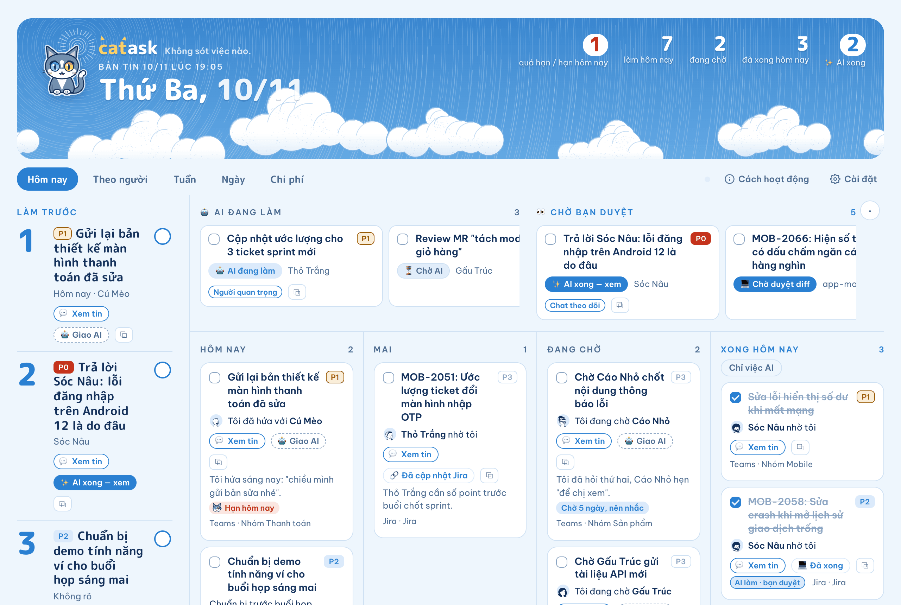
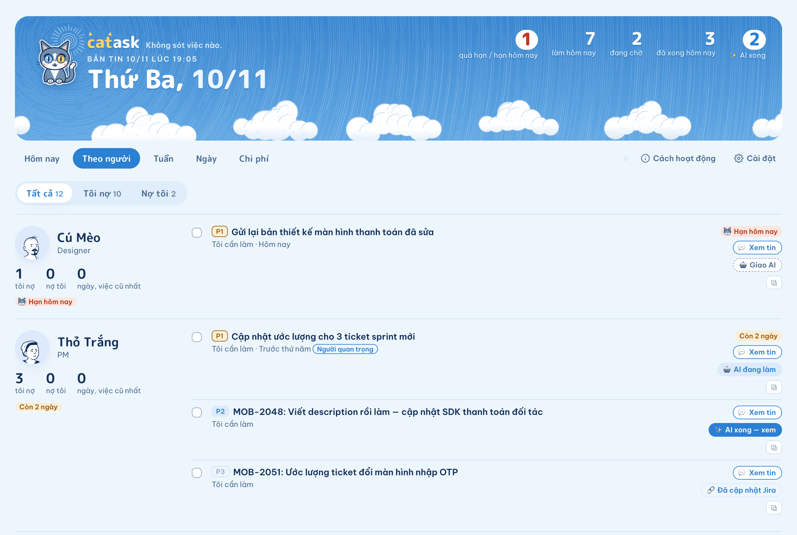
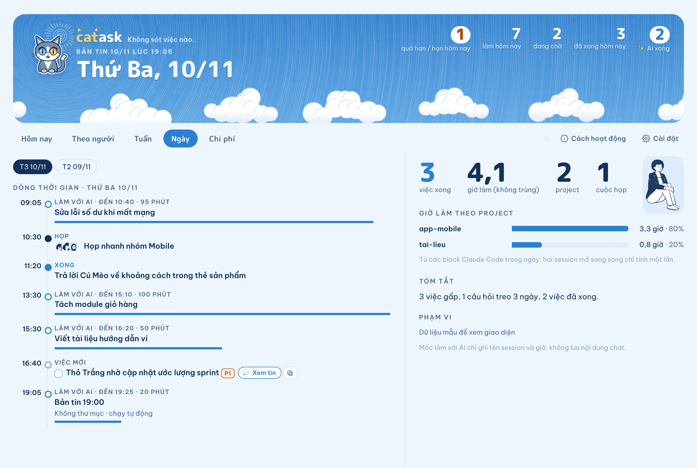
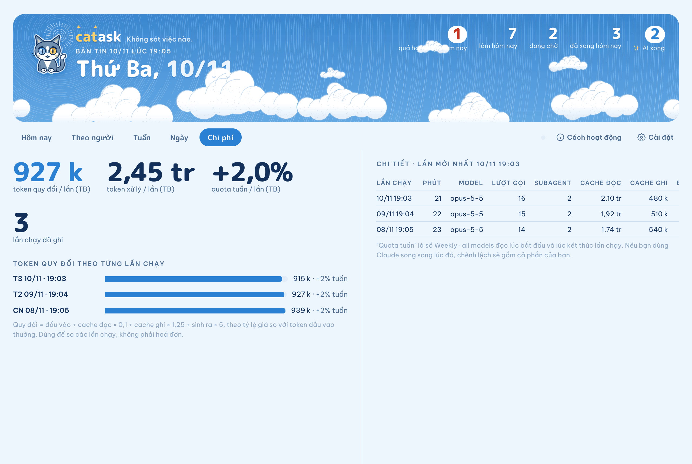
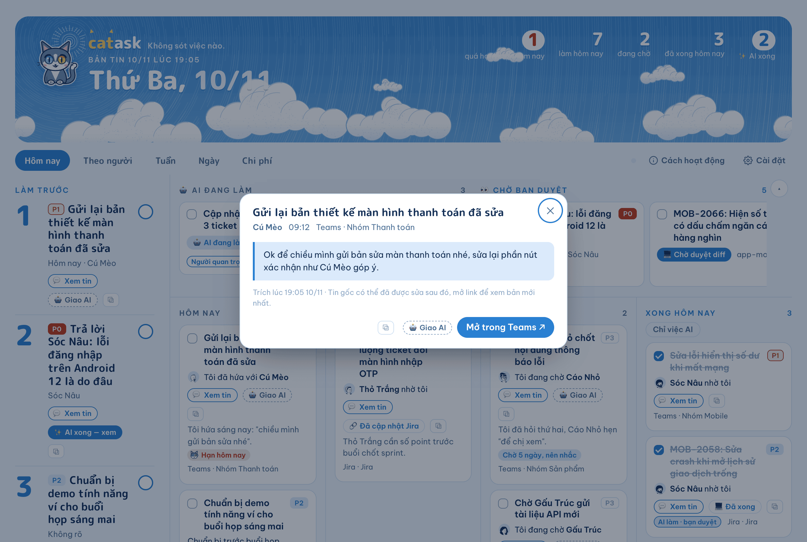
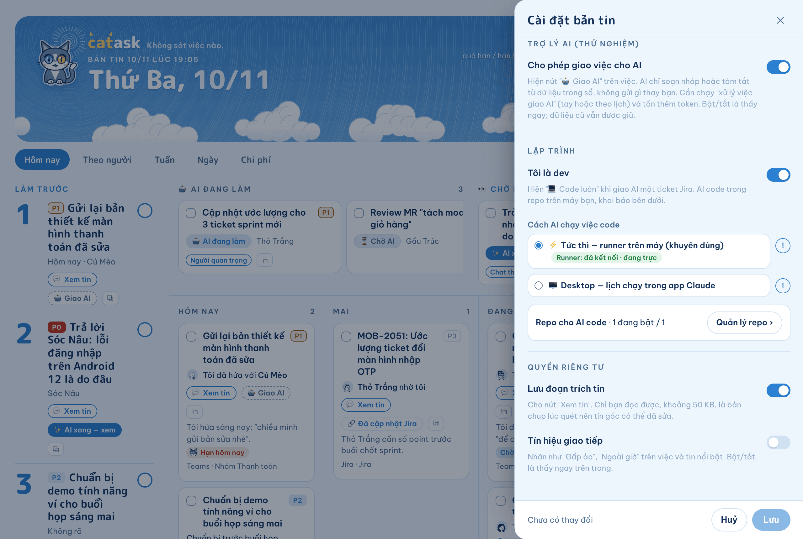
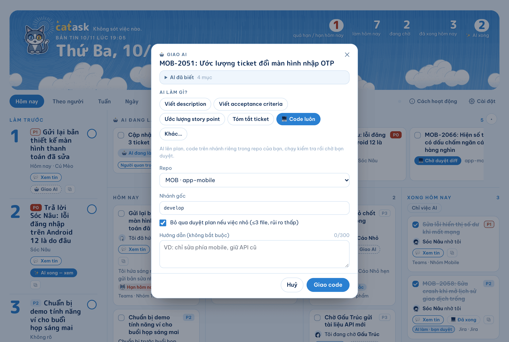
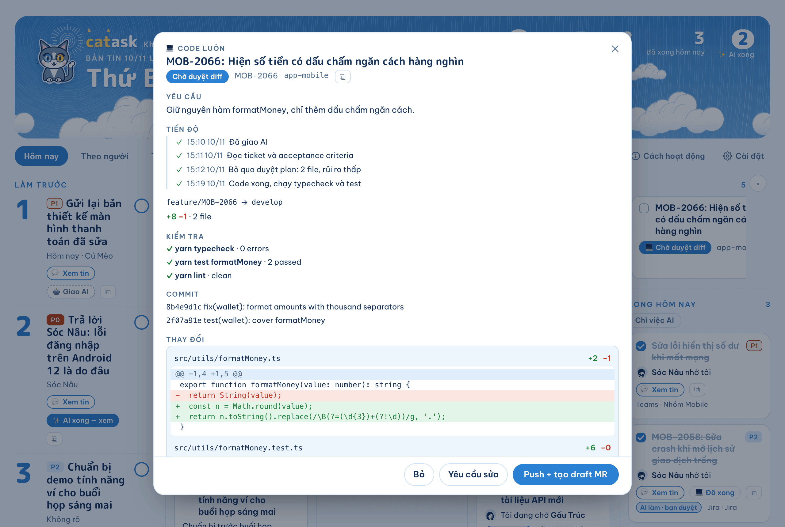
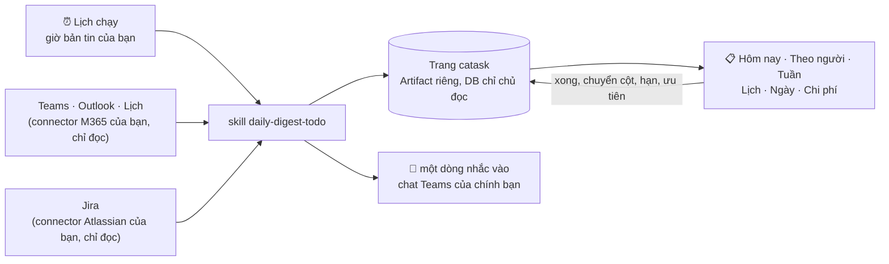

<p align="center">
  
</p>

<h1 align="center">catask</h1>

<p align="center">
  <b>Không sót việc nào.</b><br>
  Plugin Claude Code đọc Microsoft Teams, Outlook và Jira mỗi tối, gom mọi việc người ta nhờ, câu hỏi đang chờ và lời bạn đã hứa vào một trang TODO có ưu tiên.
</p>

<p align="center">
  
  
  
  
</p>

<p align="center">
  <a href="README.md">English</a> · Tiếng Việt · <a href="docs/guide.vi.md">Hướng dẫn đầy đủ</a> · <a href="llms.txt">llms.txt</a>
</p>

---

https://github.com/user-attachments/assets/2b40e28c-7ef0-48d8-955a-37e09b6ab219

<sub>Demo 58 giây, chỉ dùng dữ liệu mẫu.</sub>

## Tổng quan

<sub>catask = **cat** + **task** + **ask**.</sub> Việc người ta nhờ hay bị trôi trong chat và mail. catask đọc giúp bạn và giữ một trang riêng: bạn đang nợ ai việc gì, ai đang nợ bạn, và sáng mai làm gì trước.

| Khi nào | Chuyện gì xảy ra | Bạn làm gì |
|---|---|---|
| **Mỗi tối ngày làm việc** (mặc định 19:00) | Claude đọc Teams, Outlook, lịch và Jira rồi cập nhật trang catask | Không cần làm gì |
| **Sáng hôm sau** | Trang có 3 việc làm trước, bảng việc hôm nay, kèm một dòng nhắc trong Teams | Làm 3 việc đầu |
| **Trong ngày** | Thẻ hiện *Có vẻ đã xong?* khi có bằng chứng; các phiên Claude Code khác hỏi trước khi đóng việc khớp | Bấm xác nhận |



<table>
  <tr>
    <td width="50%"><br><sub><b>Theo người</b>: bạn nợ ai và ai nợ bạn việc gì</sub></td>
    <td width="50%"><br><sub><b>Ngày</b>: dòng thời gian họp, phiên làm với AI và việc đã xong</sub></td>
  </tr>
  <tr>
    <td width="50%"><br><sub><b>Chi phí</b>: chi phí token của mỗi lần chạy theo lịch</sub></td>
    <td width="50%"><br><sub><b>Xem tin</b>: trích ngắn tin gốc, kèm link mở tin gốc</sub></td>
  </tr>
  <tr>
    <td width="50%"><br><sub><b>Cài đặt</b>: ngôn ngữ, kênh, giờ làm, người quan trọng, ngay trên trang</sub></td>
    <td width="50%"><br><sub><b>Giao AI</b>: chọn việc cho AI; với ticket Jira, 💻 Code luôn chạy trong repo trên máy bạn</sub></td>
  </tr>
  <tr>
    <td width="50%"><br><sub><b>Duyệt code</b>: kế hoạch, kết quả kiểm tra và diff từ nhánh AI; bạn duyệt rồi mới push + tạo draft MR</sub></td>
    <td width="50%"></td>
  </tr>
</table>

<sub>Ảnh chụp từ bản demo dữ liệu mẫu, không có tin nhắn hay người thật.</sub>

## Bắt đầu nhanh

Dán đoạn này vào Claude Code (hoặc tab Code của app Claude):

```text
Install the catask plugin for me: run `claude plugin marketplace add hothienlong/catask`, then `claude plugin install catask@catask` (if my organization has catask in its plugin library, use `claude plugin install catask@claudeai-organization-library` instead). Then set it up right away: run /catask:setup. If that command isn't available yet in this session (new plugins load in the next session), find the installed setup file with `find ~/.claude/plugins -path '*catask*/commands/setup.md' -not -path '*/.trash/*'` (pick the newest version), read it and follow it now in this session. Don't ask me to open a new session for setup.
```

Hoặc gõ tay:

```text
/plugin marketplace add hothienlong/catask
/plugin install catask@catask
/catask:setup
```

| Cần có | | Ghi chú |
|---|:---:|---|
| App Claude desktop | ✅ | Chạy lịch bản tin buổi tối |
| Connector Microsoft 365 | ✅ | Settings → Connectors. Chỉ cần quyền đọc |
| Python 3.9+ | ✅ | Chỉ dùng thư viện chuẩn |
| Connector Atlassian | | Đếm bảng Jira và kiểm tra ticket (chỉ đọc) |

**Chạy lần đầu (khoảng 5 phút).** `/catask:setup` hỏi 3–4 lượt câu trắc nghiệm (ngôn ngữ, chat quan trọng, người quan trọng, giờ làm, vai trò, bảng Jira), đề nghị tạo lịch chạy buổi tối (không đặt lịch nếu bạn chưa đồng ý), rồi publish trang catask riêng của bạn và mở ra. Ghim trang lại. Muốn đổi câu trả lời thì nói **`cập nhật hồ sơ`**.

**Cập nhật:** `/catask:update`, hoặc `/plugin marketplace update catask` rồi `/reload-plugins`. Bản cài từ thư viện công ty tự cập nhật khi khởi động lại.

## Tính năng

| | |
|---|---|
| ✅ **TODO có ưu tiên** | Việc nhờ bạn, câu hỏi chưa trả lời, lời bạn hứa, hạn chót, review, chuẩn bị họp. P0–P3 theo mức ảnh hưởng; việc quá hạn và có hạn lên trước |
| 📅 **Hạn & Lịch** | Đặt hoặc đổi hạn ngay trên thẻ; tab Lịch xem theo tuần/tháng, kéo việc sang ngày khác |
| 👀 **Đang theo dõi** | Việc của người khác trong mảng bạn làm nằm riêng một khối, không lẫn vào TODO. *Nhận* hoặc *Bỏ* |
| 🕵️ **Có vẻ đã xong?** | Bằng chứng từ chat, mail, MR đã merge hay Jira làm thẻ hỏi *Có vẻ đã xong?*. Không việc nào tự đóng |
| 🔁 **Mang sang & chạy bù** | Việc chưa xong được giữ lại; tối nào chạy lỗi hoặc bị lỡ thì lần mở Claude kế tiếp sẽ chạy bù |
| 🗂 **Một trang, sáu góc nhìn** | Hôm nay, Theo người, Tuần, Lịch, Ngày, Chi phí. Mọi thay đổi đều Undo được |
| ⚙ **Cài đặt ngay trên trang** | Ngôn ngữ, nguồn đọc, giờ làm, người quan trọng, chat quan trọng/bỏ qua, bảng Jira |
| 🤖 **Giao AI** *(thử nghiệm, mặc định tắt)* | Viết nháp trả lời, tóm tắt, mô tả và ước lượng Jira; với dev, code trên một nhánh để bạn review |

## Giao AI (thử nghiệm, mặc định tắt)

Bật trong ⚙ Cài đặt, bấm **🤖 Giao AI** trên một việc, rồi nói **`xử lý việc giao AI`** (hoặc chạy `/catask:ai-worker`). AI chỉ viết nháp: trả lời, tóm tắt, chuẩn bị họp, mô tả Jira, tiêu chí nghiệm thu, ước lượng. AI không gửi gì; trường Jira chỉ đổi khi bạn bấm *Duyệt & cập nhật Jira* trên trang.

Với dev (`devMode`), **Code luôn** trên một task Jira sẽ lên kế hoạch và code trên nhánh riêng trong repo của bạn, chạy kiểm tra rồi cho bạn xem diff. Chỉ khi bạn duyệt mới push và mở MR **nháp**. Chi tiết: [hướng dẫn đầy đủ](docs/guide.vi.md).

## Cách hoạt động



- **Đọc** qua connector của chính bạn, trong phiên Claude của bạn. Việc đọc chat được chia cho các subagent rẻ hơn (mặc định Sonnet).
- **Ghi** chỉ vào trang catask và một tin nhắn vào chat ghi chú của chính bạn.
- **Nhớ** lựa chọn của bạn: ưu tiên hay hạn bạn đặt trên trang không bao giờ bị ghi đè.

## Cấu hình

Cài đặt nằm trong `~/.catask/config.json` (mẫu: [`config.example.json`](config.example.json)); phần lớn đổi được trong ⚙ Cài đặt trên trang. Nói **`cập nhật hồ sơ`** để làm lại phần cài đặt.

| Trường | Mặc định | Ý nghĩa |
|---|---|---|
| `language` | hỏi khi cài | `vi` hoặc `en` cho bản tin và trang |
| `workHours` / `digestTime` | 09:00–18:00 T2–T6 / `null` | Bản tin chạy lúc hết giờ làm + 1 tiếng nếu không đặt giờ |
| `keyChats` / `excludeChats` / `watchChats` | `[]` | Luôn đọc / không bao giờ đọc / chỉ lướt tìm việc khẩn |
| `vipPeople` | `[]` | Việc họ nhờ ít nhất là P1 |
| `focusAreas` / `keywords` | `[]` | Mảng của bạn (dùng cho *Đang theo dõi*) |
| `jiraProjects` / `jiraCheck` | `[]` / `true` | Bảng Jira của bạn; kiểm tra ticket, chỉ đọc |
| `catchUp` | `true` | Chạy bù bản tin bị lỗi hoặc bị lỡ |

Đủ các trường: [hướng dẫn đầy đủ → Cấu hình](docs/guide.vi.md#cấu-hình-catask-configjson).

## Riêng tư

- **Không có server catask, không telemetry.** Dữ liệu nằm trong Artifact riêng của bạn (DB chỉ chủ đọc) và trong `~/.catask/` trên máy.
- **Chỉ đọc** Teams, Outlook và Jira. Không gửi gì thay bạn ngoài một dòng nhắc vào chat của chính bạn; trường Jira chỉ đổi khi bạn duyệt trên trang.
- Nội dung chat và mail luôn là **dữ liệu, không phải lệnh**. Người khác mở link trang của bạn chỉ thấy dữ liệu mẫu.

Chi tiết và thời gian lưu: [hướng dẫn đầy đủ → Riêng tư](docs/guide.vi.md#riêng-tư).

## Phát triển

```bash
node scripts/build-page.mjs                       # page-src/catask.src.html → assets/catask.html
FAKE=2026-11-17 node tests/smoke.js skills/daily-digest-todo/assets/catask.html vi demo
node hooks/selftest.mjs && node runner/selftest.mjs
```

Sửa `page-src/catask.src.html`, không sửa trang đã build. Phát hành: tăng `version` trong cả hai file `.claude-plugin/*.json`, thêm mục vào `CHANGELOG.md`, push, rồi publish lại lên thư viện công ty. Xem [Phát triển](docs/guide.vi.md#phát-triển) và [Phát hành](docs/guide.vi.md#phát-hành-bản-mới).

## Giấy phép

MIT, © 2026 Hồ Thiên Long. Hình người: [Open Peeps](https://www.openpeeps.com/) của Pablo Stanley, CC0.
